# Illustrated setup guide: Auth0 and Cloudflare

> Language: English | [Tiếng Việt](dashboard-walkthrough.vi.md)

This guide is written for someone configuring Auth0 and Cloudflare for the first time. Each step names the menu path, button to click, value to enter, and result to look for.

Each screenshot has a numbered title strip (`01`–`13`) **outside the original screenshot**. Read the images in numerical order. The number strip does not cover or move any dashboard button, field, or content.

> **Before you begin:** screenshots reflect one live environment at the time they were captured. Tenant names, hostnames, API Identifiers, and status can differ in another environment. Use values from your own deployment; never copy the API Identifier from a screenshot to a different server.

> **Do not create duplicates:** the illustrated environment already has a `cos-mcp` Tunnel, the `cos.bougainvillea.dpdns.org` route, an Auth0 API named `COS Multi-Account MCP`, the `mcp:connect` scope, and a `COS Email Identity` Action attached to Post Login. Check for existing resources first. Create a resource only when it is missing.

## 1. Target result

The connection flow:

1. A user opens the MCP endpoint from ChatGPT.
2. ChatGPT redirects the user to Auth0 for Google sign-in.
3. Auth0 issues an access token for the exact MCP API, including a verified email claim.
4. ContextForge validates the token, finds the active user, and checks team membership.
5. Cloudflare Tunnel forwards the HTTPS request to ContextForge at `http://127.0.0.1:4444`.

Cloudflare Tunnel handles network forwarding. Auth0 authenticates the user. ContextForge decides whether that user may call a tool.

---

## 2. Cloudflare: inspect the existing Tunnel

### Step 2.1 — Open the Tunnel list

1. Sign in to the Cloudflare Dashboard.
2. In the left navigation, open **Networking**.
3. Select **Tunnels**.
4. Find the `cos-mcp` row.

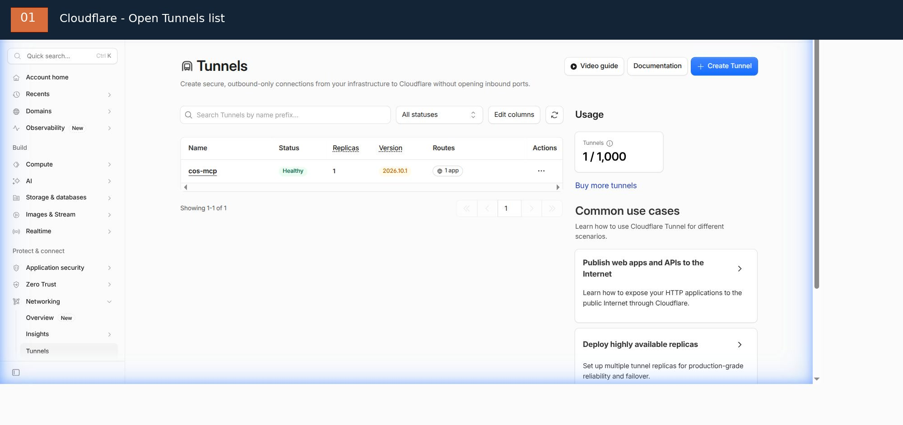

In the captured environment, `cos-mcp` is **Healthy**, with one replica and one route. If your status differs, stop and inspect `cloudflared` on the host before continuing.

### Step 2.2 — Open the Routes tab

1. Click the `cos-mcp` Tunnel name.
2. In the Tunnel tabs, select **Routes**.
3. Read the existing route. Do not click Add route if the hostname is already present.

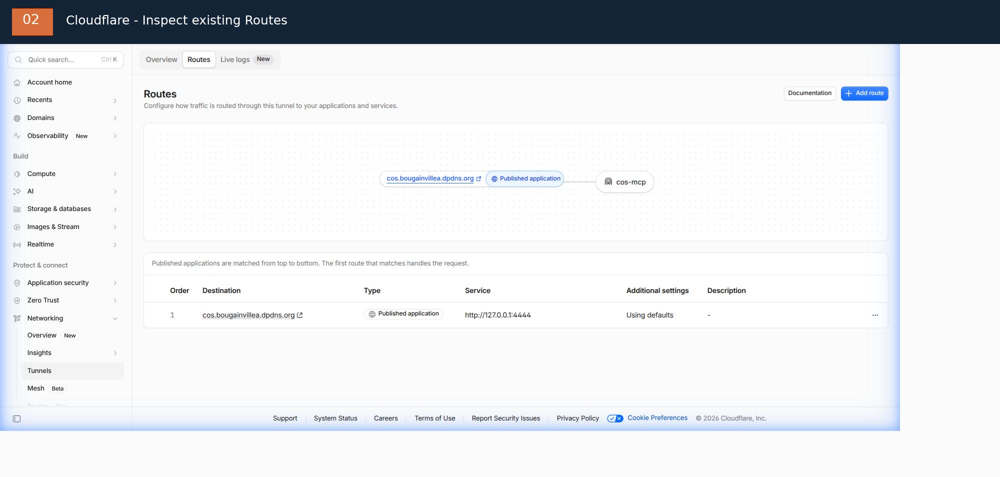

The active route shows these values:

| Field | Observed value | Meaning |
| --- | --- | --- |
| Destination | `cos.bougainvillea.dpdns.org` | Hostname users open over HTTPS |
| Type | `Published application` | Application published through the Tunnel |
| Service | `http://127.0.0.1:4444` | ContextForge running on the same host |
| Additional settings | `Using defaults` | Default settings are in use |

Remember: `cos.bougainvillea.dpdns.org` is the public hostname; `127.0.0.1:4444` is the internal service address. Do not enter `127.0.0.1` in the Subdomain or Domain field.

### Step 2.3 — Add a new route (only if no route exists)

In Routes, click **Add route**. In the route-type selector, choose **Published application**.

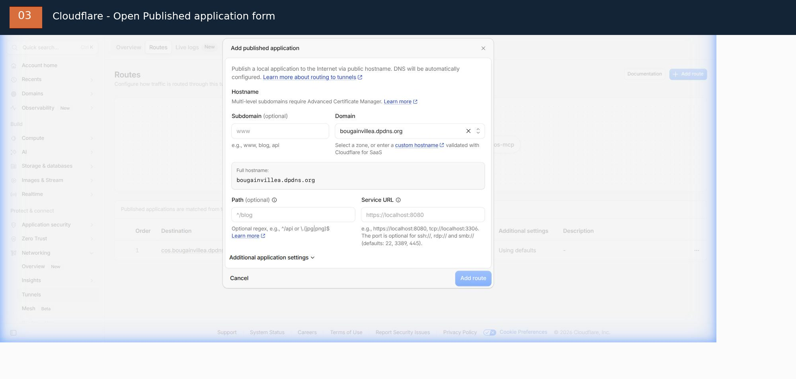

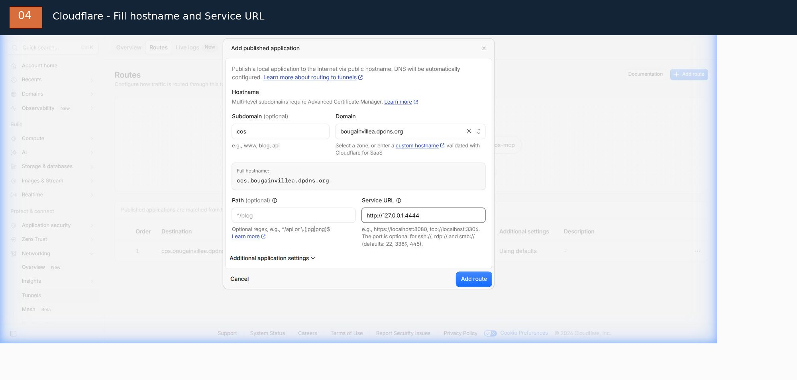

Fill in the form as follows. These are the values used by the illustrated deployment. For another environment, replace the hostname/domain with a domain you control.

| Dashboard field | Enter | Notes |
| --- | --- | --- |
| **Subdomain** | `cos` | The label before the main domain |
| **Domain** | `bougainvillea.dpdns.org` | Select the domain from the Cloudflare list |
| **Path** | Leave blank | Do not restrict the route by path at this stage |
| **Service URL** | `http://127.0.0.1:4444` | HTTP scheme, loopback address, and ContextForge port |

Cloudflare shows a **Full hostname** preview. With the values above, it must be:

```text
cos.bougainvillea.dpdns.org
```

The filled-form screenshot is an example captured before saving. Check the Full hostname and Service URL before clicking **Add route**. Cloudflare automatically creates the DNS route for a Published application. Do not add a second route if Step 2.2 already shows the correct one. In the illustrated environment, the route already exists, so inspect it rather than clicking Add route.

### Step 2.4 — Protect the administrative interface

A Published application makes the hostname reachable from the Internet. It does **not automatically protect** the ContextForge Admin UI.

Create or inspect a separate Cloudflare Access application and policy for the Admin UI and admin APIs. Grant access only to authorized operators. Do not add a rule that allows the entire Internet to reach administrative paths. Check the actual paths against the deployed ContextForge version before saving the policy.

---

## 3. Auth0: open the MCP API

### Step 3.1 — Open the API list

1. Sign in to the Auth0 Dashboard.
2. In the left navigation, open **Applications**.
3. Select **APIs**.
4. Find `COS Multi-Account MCP` and click its name.

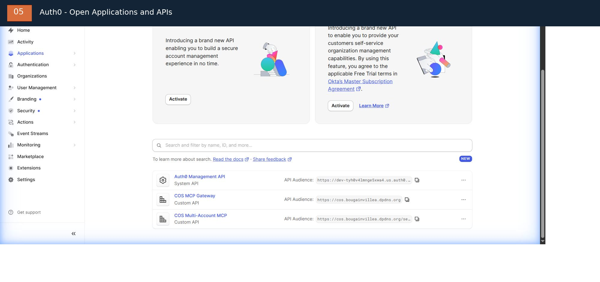

Do not confuse this API with `COS MCP Gateway` or `Auth0 Management API`. Select the API associated with the ContextForge Virtual Server.

### Step 3.1a — Create an API only if it is missing

If the API is not in the list, click **Create API**. The **Create Custom API** form appears:

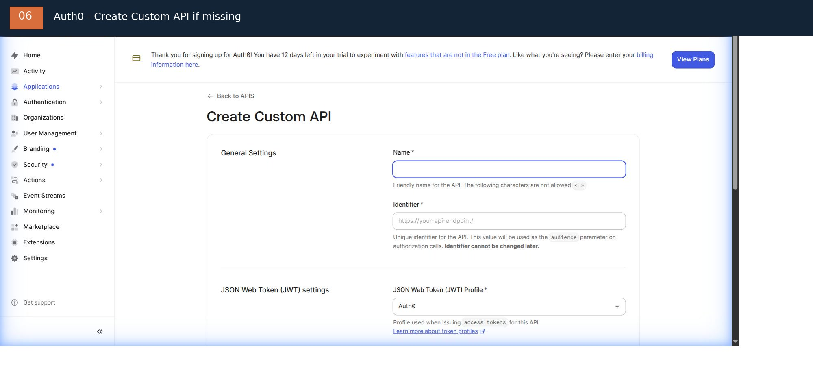

Fill in these fields:

| Field | Value |
| --- | --- |
| **Name** | `COS Multi-Account MCP` |
| **Identifier** | The `resource` value from metadata in Step 3.2; paste it exactly |
| **JSON Web Token (JWT) Profile** | `RFC 9068` |
| **JSON Web Token (JWT) Signing Algorithm** | `RS256` |

The Identifier cannot be changed after the API is created. If you have not retrieved `resource` from the correct Virtual Server, click **Cancel** and fetch the metadata first. Do not guess and create the API prematurely.

The form also has **Access Policy for Applications** (user-delegated access and client access). These are OAuth-client authorization policies, not the `mcp:connect` scope. Do not select **All apps allowed** or enable client-credentials merely to make a login error disappear. Keep the policy designed for the deployment's OAuth client; ordinary user login does not require a client-credentials grant.

After checking the fields, scroll to the bottom and create the API. Continue to Step 3.3 to verify its Settings. If `COS Multi-Account MCP` already exists, skip the entire creation step.

### Step 3.2 — Verify the Identifier

When the API opens, find **Identifier**. This is the audience the access token must contain.

To retrieve the correct value from your server, open the metadata endpoint:

```text
https://<hostname>/.well-known/oauth-protected-resource/servers/<server-id>/mcp
```

In the returned JSON, find the `resource` field. The Auth0 Identifier must match `resource` **character for character**, including `https://`, the path, and a trailing slash if present.

Example command to fetch metadata (replace the hostname and server ID with the real values):

```bash
curl -fsS \
  "https://<hostname>/.well-known/oauth-protected-resource/servers/<server-id>/mcp"
```

Do not copy an Identifier from a screenshot or guess the server ID. If the API already exists, verify its value; do not create another API just to follow the tutorial.

### Step 3.3 — Verify Settings

In the API, select the **Settings** tab. Find **Access Token Settings**.

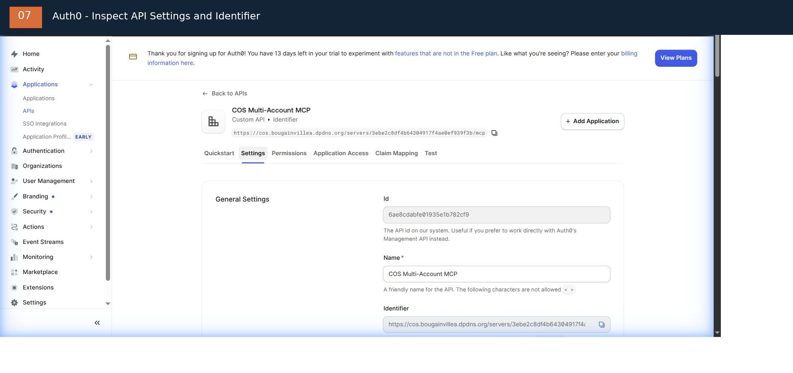

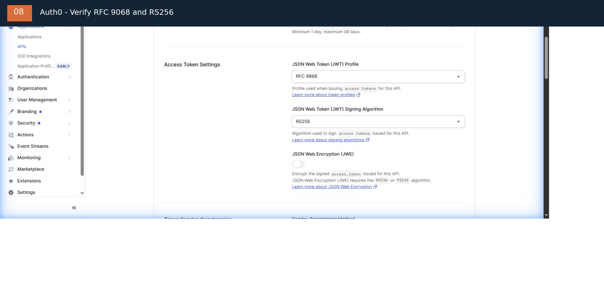

Check these values:

| Field | Required value |
| --- | --- |
| Identifier | `resource` retrieved from metadata in Step 3.2 |
| JSON Web Token (JWT) Profile | `RFC 9068` |
| JSON Web Token (JWT) Signing Algorithm | `RS256` |
| JSON Web Encryption (JWE) | Off, unless the deployment design explicitly requires token encryption |

The captured page already shows `RFC 9068` and `RS256`. If they are correct, leave them unchanged. If you need to change them, click Save at the bottom only after verifying the audience and preparing a rollback plan.

### Step 3.4 — Verify the `mcp:connect` permission

1. In the API, open the **Permissions** tab.
2. Find **List of Permissions**.
3. Confirm that `mcp:connect` is present.

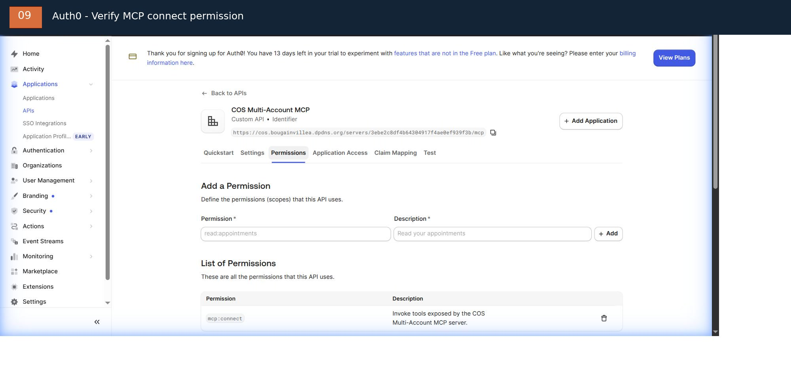

The existing scope describes permission to invoke tools exposed by COS Multi-Account MCP. If it is missing, enter the following under **Add a Permission**:

| Field | Value |
| --- | --- |
| Permission | `mcp:connect` |
| Description | `Invoke tools exposed by the COS Multi-Account MCP server.` |

Then click **Add**. If `mcp:connect` is already listed, skip the addition; do not create a duplicate scope.

---

## 4. Auth0: configure Google / Gmail

### Step 4.1 — Open the Google Social Connection

1. In the left navigation, open **Authentication**.
2. Select **Social**.
3. Select the **google-oauth2** connection (Google / Gmail).
4. Open the **Settings** tab.

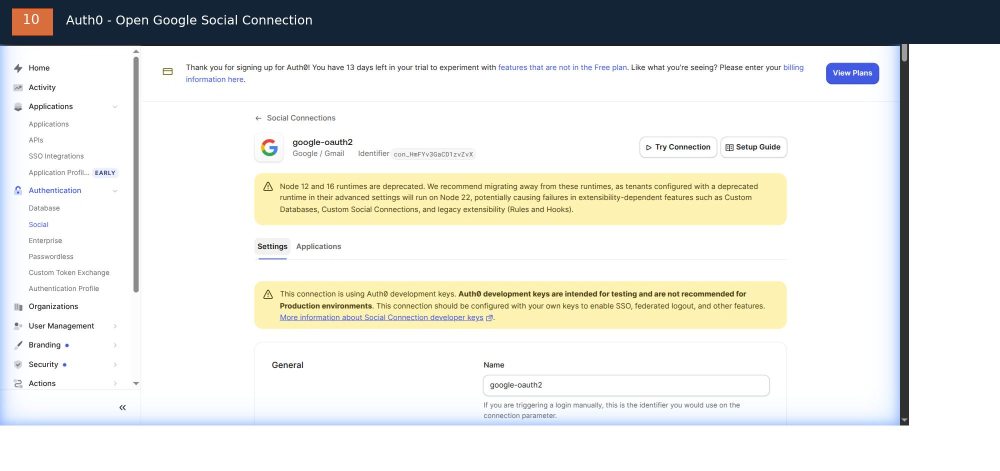

The captured dashboard warns that the connection uses **Auth0 development keys**. These are for testing only and must not be used in production. The Client ID and Client Secret fields are blank in the captured view; do not leave them blank for a production deployment.

### Step 4.2 — Create a Google OAuth Client

Open the Google Cloud Console for a project you own. In the current Google Auth Platform interface:

1. Select **Google Auth Platform**.
2. Open **Clients**.
3. Click **Create Client**.
4. For Application type, select **Web application**.
5. For Name, enter a value such as `Auth0 Google Login`.
6. Under **Authorized redirect URIs**, click **Add URI**.
7. Return to the Auth0 Google connection and click **Setup guide** to see the callback URL Auth0 assigns to this connection. Copy that exact URL into the Google Cloud Authorized redirect URI field.
8. Click **Create** in Google Cloud.
9. Copy the issued **Client ID** and **Client Secret**.

The Redirect URI must match exactly. Do not type an approximate value, change `https` to `http`, or remove a path or trailing slash. Google rejects mismatched URIs.

Official references: [Google OAuth 2.0 — Web Server Applications](https://developers.google.com/identity/protocols/oauth2/web-server) and [Auth0 Google Social Connection guide](https://developer.auth0.com/resources/labs/authentication/google-social-connection-to-login).

### Step 4.3 — Paste the Client ID and Client Secret into Auth0

Return to Auth0 > Authentication > Social > google-oauth2 > Settings. Scroll to **General**.

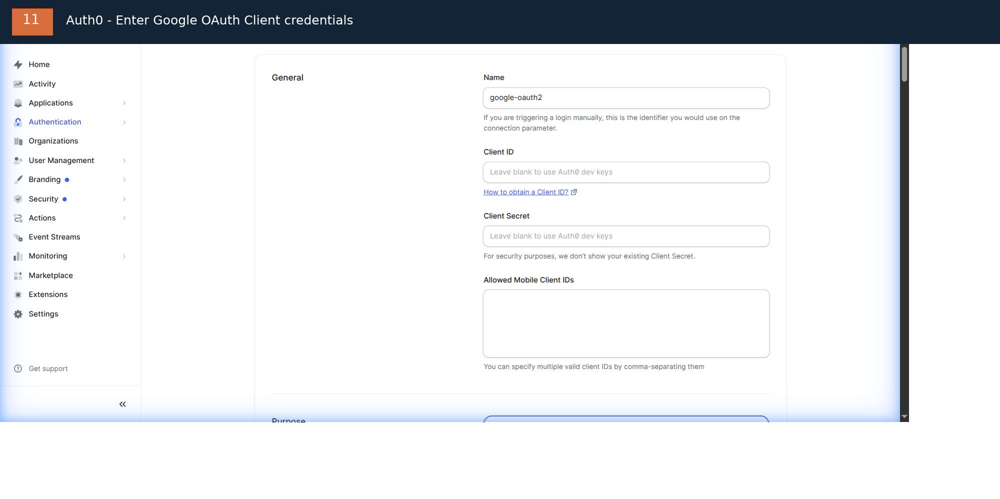

Fill in:

| Auth0 field | Action |
| --- | --- |
| **Name** | Keep `google-oauth2` |
| **Client ID** | Paste the Client ID created in Google Cloud |
| **Client Secret** | Paste the Client Secret created in Google Cloud |
| **Allowed Mobile Client IDs** | Leave blank unless you use a separate mobile client |
| **Purpose** | Select `Authentication` to use Google for sign-in |

Scroll to the bottom and click **Save Changes**. In the captured page, **Authentication** is already selected. Keep it selected for a sign-in connection; do not select Connected Accounts unless you have deliberately designed a Token Vault deployment.

Never paste the Client Secret into documentation, Git, screenshots, chat, or terminal history. If a secret is exposed, revoke it in Google Cloud and create a replacement.

---

## 5. Auth0: inspect the Post-Login Action

The Action runs after a successful user sign-in and before Auth0 issues the token.

### Step 5.1 — Open the Post Login trigger

1. In the left navigation, open **Actions**.
2. Select **Triggers**.
3. Under **Sign Up & Login**, open the **post-login** trigger.

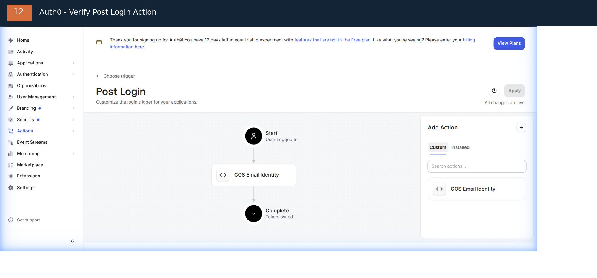

In the inspected tenant, `COS Email Identity` is already between **Start** and **Complete**. The **Apply** button is disabled and the page says **All changes are live**. The Action is already attached; do not drag in a duplicate and do not click Apply unnecessarily.

### Step 5.2 — Inspect the Action currently running in this tenant

1. Click **COS Email Identity** in the flow.
2. On the Action page, check for **Action is up to date**.
3. Open the **Secrets** tab in the left toolbar.

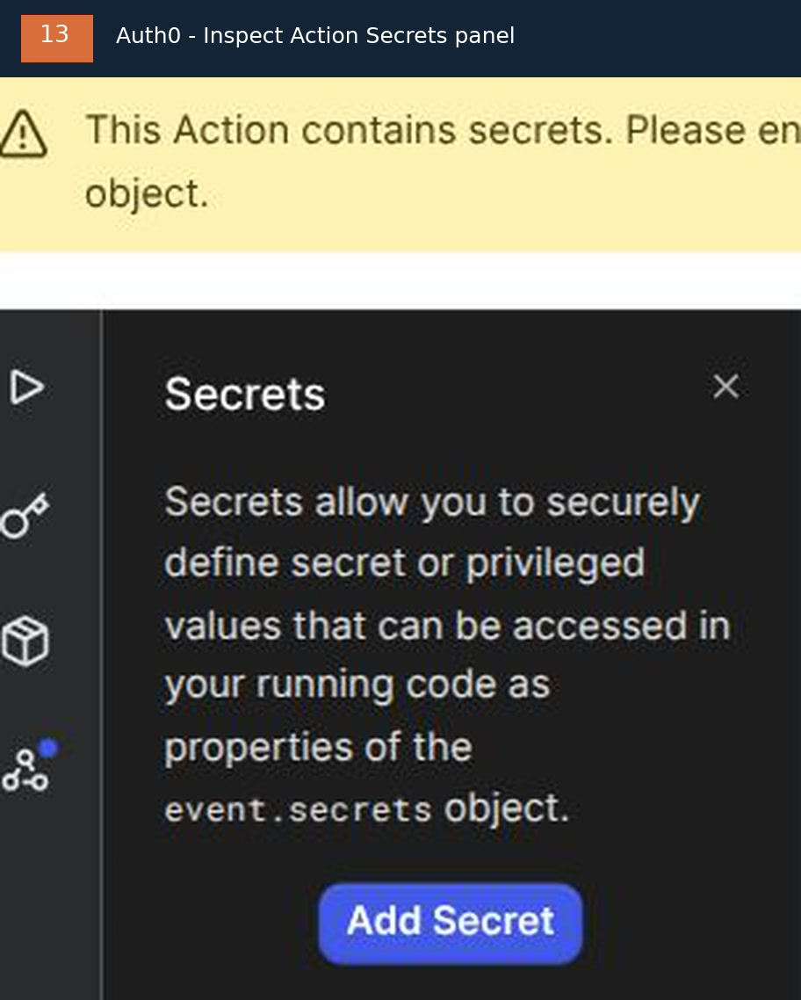

In the illustrated tenant, the **Secrets panel is empty**. This is consistent with the current code: the Action uses two hard-coded values and does not read `event.secrets`. Therefore:

| Value in Action code | Current value |
| --- | --- |
| `expectedResource` | Exact Virtual Server Identifier/`resource`, retrieved in Step 3.2 |
| URI passed to `api.accessToken.setCustomClaim(...)` | `https://bougainvillea.dpdns.org/email` |

The code checks `event.resource_server?.identifier`, runs only for the correct MCP API, rejects unverified email, and emits a custom email claim. The `.env` value `MCP_OAUTH_EMAIL_CLAIM` must exactly match the claim URI in the table.

**Do not add** `MCP_RESOURCE_IDENTIFIER` or `MCP_EMAIL_CLAIM` to the Secrets panel of this currently deployed Action. If you change the Virtual Server, hostname, or claim URI, update the matching strings in the Action code and `.env` together, then review/test before deploying. The current Action also contains an alias branch restricted to one already-provisioned Google identity. This is a tenant-specific exception; do not copy that person's email or subject into shared documentation, and do not extend the exception to other people.

### Step 5.3 — Create an Action for a different tenant (generic template)

Use this section only when building a new tenant and choosing the **generic Action-secrets template** in [oauth-setup.md](oauth-setup.md#3-add-a-post-login-action). Do not use it to modify the illustrated tenant as-is:

1. Under **Actions > Triggers > post-login**, in **Add Action**, click **Create Action**.
2. Select **Build from scratch**.
3. Name: `COS Email Identity`.
4. Trigger: `Login / Post Login`.
5. Create the Action and use the generic code from `oauth-setup.md`; it must read `event.secrets.MCP_RESOURCE_IDENTIFIER` and `event.secrets.MCP_EMAIL_CLAIM`.
6. In the Action editor, open **Secrets**, click **Add Secret**, and add both entries:

| Secret name | Value to paste |
| --- | --- |
| `MCP_RESOURCE_IDENTIFIER` | Exact `resource` retrieved from metadata in Step 3.2 |
| `MCP_EMAIL_CLAIM` | Your chosen custom-claim URI, e.g. `https://<your-domain>/claims/email` |

7. Confirm both secret names appear in the list (Auth0 does not show secret values again after saving).
8. Click **Deploy** in the Action editor.
9. Return to **Actions > Triggers > post-login**. In the **Custom** tab, drag the new Action into the flow between **Start** and **Complete**.
10. Click **Apply** if the button is enabled; confirm the page says **All changes are live**.

The Action must run only for the correct MCP audience, reject absent or unverified email (`email_verified !== true`), and emit the lowercased email in the custom claim. Never log tokens or secrets.

### Step 5.4 — Synchronize the claim with ContextForge

For the illustrated tenant, the ContextForge `.env` must contain:

```dotenv
MCP_OAUTH_EMAIL_CLAIM=https://bougainvillea.dpdns.org/email
```

For a new generic Action from Step 5.3, set `MCP_OAUTH_EMAIL_CLAIM` to exactly the value stored in the `MCP_EMAIL_CLAIM` secret:

```dotenv
MCP_OAUTH_EMAIL_CLAIM=https://<your-domain>/claims/email
```

Replace `<your-domain>` with a domain you control. Do not keep the example value unless the Action is configured to issue that exact claim. These are two alternative Action implementations; do not mix hard-coded code with instructions to add secrets.

---

## 6. Verify before connecting ChatGPT

1. Cloudflare: Tunnel `cos-mcp` must be Healthy and the hostname route must target `http://127.0.0.1:4444`.
2. ContextForge: protected-resource metadata must return HTTP 200 and its `resource` field must match the Auth0 API Identifier.
3. Auth0: API uses RS256, RFC 9068, and scope `mcp:connect`.
4. Auth0 Google connection: uses a Client ID/Secret owned by the operator; development keys are not used for production.
5. Auth0: Post Login contains `COS Email Identity` and the email claim is synchronized with `.env`.
6. ContextForge: each person has been provisioned as an active local user and added to the team with the appropriate role.

A successful Google sign-in does not prove that MCP checked the audience, claim, or RBAC correctly. Then connect ChatGPT using the Virtual Server's HTTPS endpoint and verify that the tools appear.

---

## 7. Re-capture and process screenshots

Raw screenshots are not stored in the repository. The images in `docs/assets/` are processed with FFmpeg.

For new dashboard captures, use:

```bash
bash docs/assets/process-dashboard-screenshots.sh \
  /path/to/auth0-apis-raw.jpg \
  /path/to/cloudflare-tunnels-raw.jpg \
  docs/assets
```

The script processes the two list screenshots. For individual forms/steps, use FFmpeg similarly to mask the header/email and identify the relevant controls. Never include Client Secrets, bearer tokens, API keys, Tunnel tokens, or login credentials in an image.

To render the diagrams, video, and GIF again:

```bash
bash docs/assets/render.sh
```
