# Hướng dẫn bằng hình ảnh: thiết lập Auth0 và Cloudflare

> Ngôn ngữ: [English](dashboard-walkthrough.md) | Tiếng Việt

Tài liệu này dành cho người lần đầu cấu hình Auth0 và Cloudflare. Mỗi bước ghi rõ đường dẫn menu, nút cần bấm, giá trị cần nhập và kết quả cần nhìn thấy.

Mỗi screenshot có số thứ tự `01`–`13` trong dải tiêu đề nằm **bên ngoài ảnh gốc**. Đọc ảnh theo số này từ trên xuống. Dải số không che hoặc dịch chuyển bất kỳ nút, ô nhập hay nội dung dashboard nào.

> **Đọc trước khi thao tác:** ảnh chụp phản ánh dashboard của một môi trường đang chạy tại thời điểm chụp. Tên tenant, hostname, API Identifier và trạng thái có thể khác ở môi trường khác. Hãy dùng giá trị lấy từ chính môi trường của bạn; không sao chép API Identifier của ảnh sang một server khác.

> **Đừng tạo trùng:** cấu hình hiện tại đã có Tunnel `cos-mcp`, route `cos.bougainvillea.dpdns.org`, Auth0 API `COS Multi-Account MCP`, scope `mcp:connect` và Action `COS Email Identity` trong Post Login. Trước tiên hãy kiểm tra tài nguyên đã tồn tại. Chỉ tạo mới khi thiếu.

## 1. Kết quả cần đạt

Luồng kết nối:

1. Người dùng mở MCP endpoint bằng ChatGPT.
2. ChatGPT chuyển người dùng sang Auth0 để đăng nhập Google.
3. Auth0 phát access token cho đúng MCP API, kèm email đã xác minh.
4. ContextForge kiểm tra token, tìm user đang hoạt động và quyền thành viên team.
5. Cloudflare Tunnel chuyển HTTPS request tới ContextForge tại `http://127.0.0.1:4444`.

Cloudflare Tunnel chỉ lo chuyển tiếp mạng. Auth0 xác thực người dùng. ContextForge mới là nơi quyết định user có quyền gọi tool hay không.

---

## 2. Cloudflare: kiểm tra Tunnel hiện có

### Bước 2.1 — Mở danh sách Tunnel

1. Đăng nhập Cloudflare Dashboard.
2. Ở menu trái, mở **Networking**.
3. Chọn **Tunnels**.
4. Tìm dòng `cos-mcp`.

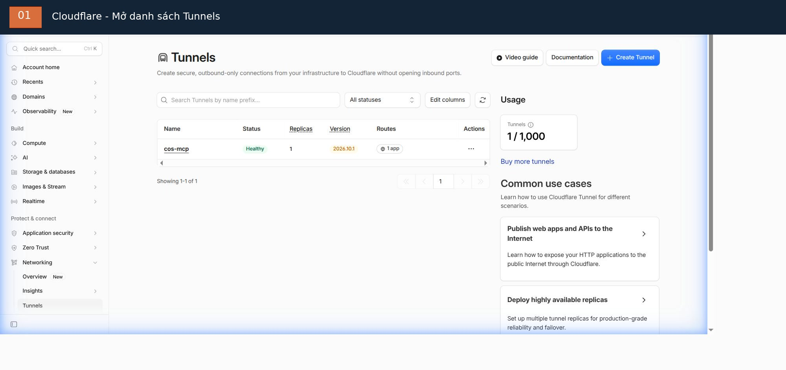

Trong ảnh hiện tại, `cos-mcp` có trạng thái **Healthy**, một replica và một route. Nếu bạn thấy trạng thái khác, dừng lại và kiểm tra `cloudflared` trên máy chủ trước khi làm tiếp.

### Bước 2.2 — Mở tab Routes

1. Bấm tên Tunnel `cos-mcp`.
2. Trên thanh tab của Tunnel, chọn **Routes**.
3. Đọc dòng route hiện có, không bấm Add route nếu hostname đã có.

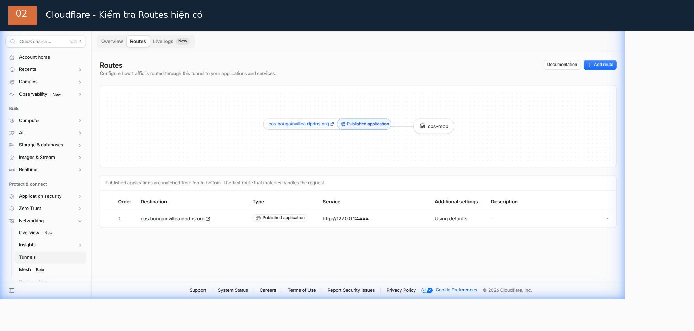

Route đang chạy có các giá trị:

| Trường | Giá trị đang thấy | Ý nghĩa |
| --- | --- | --- |
| Destination | `cos.bougainvillea.dpdns.org` | Hostname người dùng truy cập qua HTTPS |
| Type | `Published application` | Ứng dụng public qua Tunnel |
| Service | `http://127.0.0.1:4444` | ContextForge chạy trên cùng máy chủ |
| Additional settings | `Using defaults` | Đang dùng thiết lập mặc định |

Điểm cần nhớ: `cos.bougainvillea.dpdns.org` là hostname public; `127.0.0.1:4444` là địa chỉ dịch vụ nội bộ. Không nhập `127.0.0.1` vào ô Subdomain hoặc Domain.

### Bước 2.3 — Tạo route mới (chỉ khi chưa có route)

Trong Routes, bấm **Add route**. Ở hộp chọn loại route, chọn **Published application**.

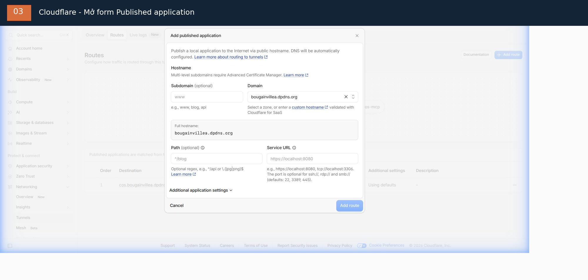

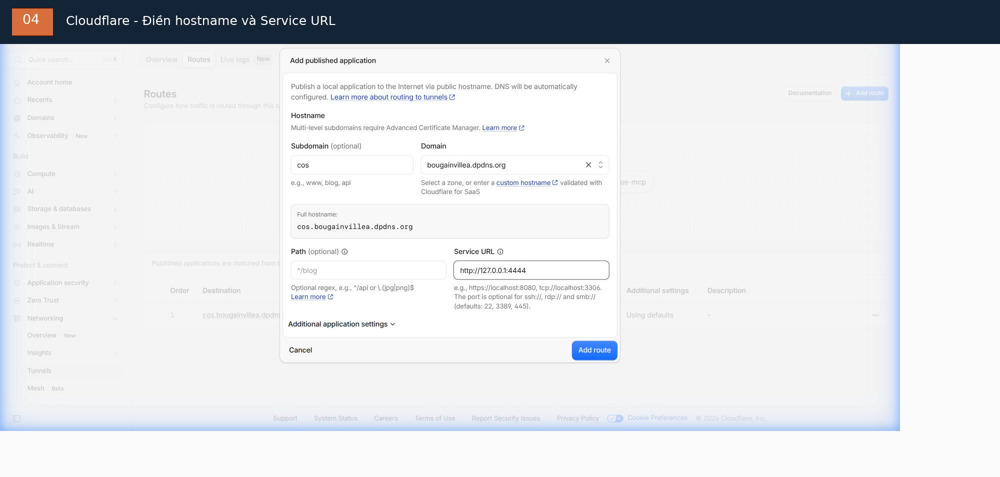

Điền form như sau. Đây là giá trị của triển khai hiện tại; thay hostname/domain bằng domain bạn quản lý nếu triển khai ở môi trường khác.

| Ô trên dashboard | Nhập gì | Ghi chú |
| --- | --- | --- |
| **Subdomain** | `cos` | Phần đứng trước domain chính |
| **Domain** | `bougainvillea.dpdns.org` | Chọn domain từ danh sách Cloudflare |
| **Path** | Để trống | Không giới hạn route theo path ở bước này |
| **Service URL** | `http://127.0.0.1:4444` | Giao thức HTTP, địa chỉ loopback và port ContextForge |

Cloudflare hiển thị **Full hostname** để bạn kiểm tra. Với các giá trị trên, kết quả phải là:

```text
cos.bougainvillea.dpdns.org
```

Ảnh form đã điền là ví dụ thao tác, được chụp trước khi lưu. Kiểm tra lại Full hostname và Service URL trước khi bấm **Add route**. Cloudflare tự tạo DNS route cho Published application. Không tạo route thứ hai nếu bước 2.2 đã cho thấy route đúng; với môi trường đang minh họa, route đã tồn tại nên chỉ cần kiểm tra, không bấm Add route.

### Bước 2.4 — Bảo vệ trang quản trị

Published application khiến hostname có thể truy cập từ Internet. Điều đó **không tự động bảo vệ** trang quản trị ContextForge.

Tạo/kiểm tra Cloudflare Access application và policy riêng cho Admin UI, admin API; chỉ cấp quyền cho operator được phép. Không thêm rule cho phép toàn Internet vào đường dẫn quản trị. Đối chiếu path thực tế với phiên bản ContextForge đang chạy trước khi lưu policy.

---

## 3. Auth0: mở đúng API dành cho MCP

### Bước 3.1 — Mở API list

1. Đăng nhập Auth0 Dashboard.
2. Menu trái: mở **Applications**.
3. Chọn **APIs**.
4. Tìm `COS Multi-Account MCP` rồi bấm tên API đó.

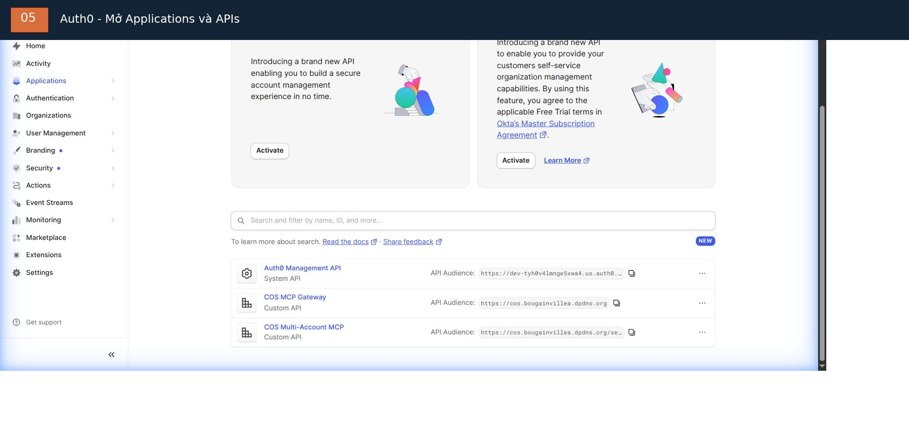

Không nhầm API này với `COS MCP Gateway` hoặc `Auth0 Management API`. Phải chọn đúng API gắn với ContextForge Virtual Server.

### Bước 3.1a — Chỉ tạo API khi chưa tồn tại

Nếu API chưa có trong danh sách, bấm **Create API**. Form **Create Custom API** xuất hiện như ảnh:

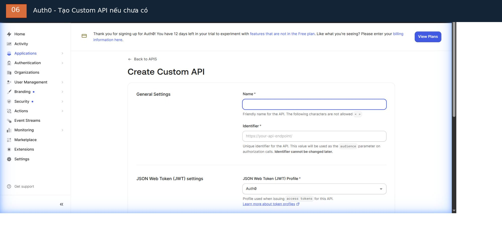

Điền các trường:

| Ô | Giá trị |
| --- | --- |
| **Name** | `COS Multi-Account MCP` |
| **Identifier** | Trường `resource` lấy từ metadata ở bước 3.2; dán nguyên giá trị |
| **JSON Web Token (JWT) Profile** | `RFC 9068` |
| **JSON Web Token (JWT) Signing Algorithm** | `RS256` |

Identifier không thể thay đổi sau khi tạo API. Nếu chưa lấy được `resource` từ đúng Virtual Server, bấm **Cancel** và lấy metadata trước; đừng đoán rồi tạo API.

Form còn hai mục **Access Policy for Applications** (user-delegated access và client access). Đây là chính sách cấp quyền cho OAuth client, không phải scope `mcp:connect`. Không chọn **All apps allowed** hoặc bật client-credentials chỉ để làm mất lỗi đăng nhập. Giữ chính sách đã được thiết kế cho OAuth client của deployment; ordinary user login không cần client-credentials grant.

Sau khi kiểm tra xong các trường, kéo xuống cuối trang và bấm nút tạo API. Tiếp tục bước 3.3 để kiểm tra lại Settings. Nếu API `COS Multi-Account MCP` đã tồn tại thì bỏ qua toàn bộ bước tạo mới.

### Bước 3.2 — Kiểm tra Identifier

Khi mở API, nhìn phần **Identifier**. Đây chính là audience mà access token phải mang.

Để lấy giá trị đúng từ server của bạn, mở metadata endpoint:

```text
https://<hostname>/.well-known/oauth-protected-resource/servers/<server-id>/mcp
```

Trong JSON trả về, tìm trường `resource`. Identifier trong Auth0 phải bằng `resource` **từng ký tự một**, kể cả `https://`, path và dấu `/` cuối nếu có.

Ví dụ lệnh lấy metadata (thay hostname và server ID bằng giá trị thật):

```bash
curl -fsS \
  "https://<hostname>/.well-known/oauth-protected-resource/servers/<server-id>/mcp"
```

Đừng lấy Identifier từ ảnh chụp hoặc tự đoán server ID. Nếu API đã tồn tại, kiểm tra giá trị; không tạo API mới chỉ vì muốn làm theo tutorial.

### Bước 3.3 — Kiểm tra Settings

Trong API, chọn tab **Settings**. Tìm phần **Access Token Settings**.

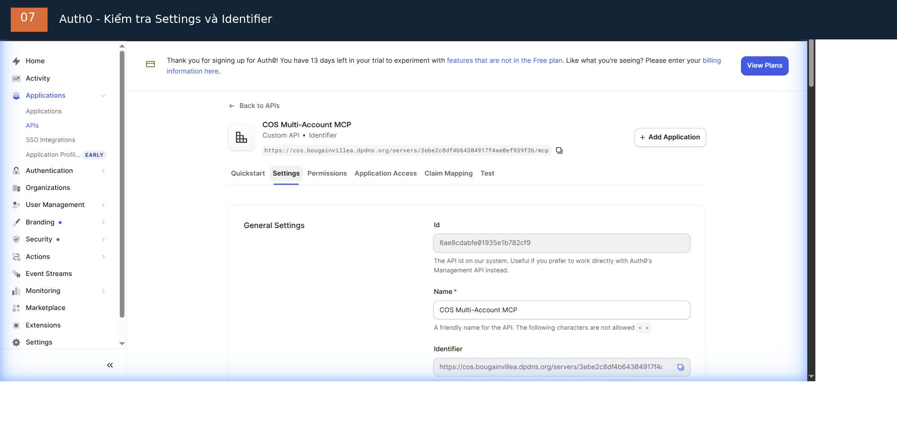

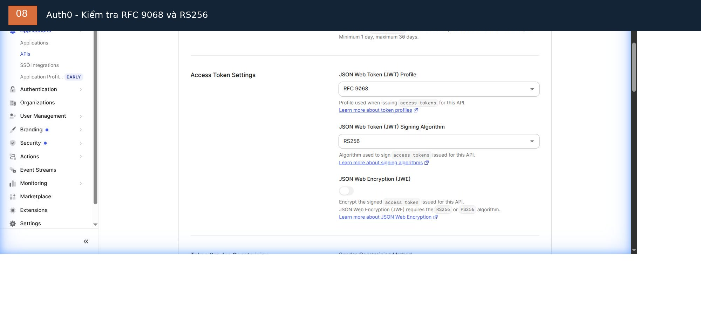

Đối chiếu:

| Trường | Giá trị cần có |
| --- | --- |
| Identifier | `resource` lấy từ metadata ở bước 3.2 |
| JSON Web Token (JWT) Profile | `RFC 9068` |
| JSON Web Token (JWT) Signing Algorithm | `RS256` |
| JSON Web Encryption (JWE) | Tắt, trừ khi thiết kế triển khai yêu cầu mã hóa token |

Ảnh hiện tại cho thấy `RFC 9068` và `RS256` đã được chọn. Nếu đã đúng thì không cần đổi. Nếu thay đổi, chỉ bấm Save ở cuối trang sau khi đã xác minh audience và có kế hoạch rollback.

### Bước 3.4 — Kiểm tra Permission `mcp:connect`

1. Trong API, mở tab **Permissions**.
2. Nhìn phần **List of Permissions**.
3. Xác nhận đã có `mcp:connect`.

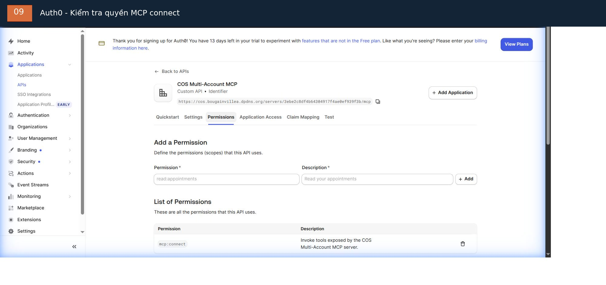

Scope hiện có mô tả quyền gọi các tool do COS Multi-Account MCP cung cấp. Nếu chưa có, tại **Add a Permission** nhập:

| Ô | Giá trị |
| --- | --- |
| Permission | `mcp:connect` |
| Description | `Invoke tools exposed by the COS Multi-Account MCP server.` |

Sau đó bấm **Add**. Nếu `mcp:connect` đã nằm trong danh sách, bỏ qua thao tác thêm; không tạo scope trùng.

---

## 4. Auth0: cấu hình Google / Gmail

### Bước 4.1 — Mở Google Social Connection

1. Menu trái: mở **Authentication**.
2. Chọn **Social**.
3. Chọn connection **google-oauth2** (Google / Gmail).
4. Mở tab **Settings**.

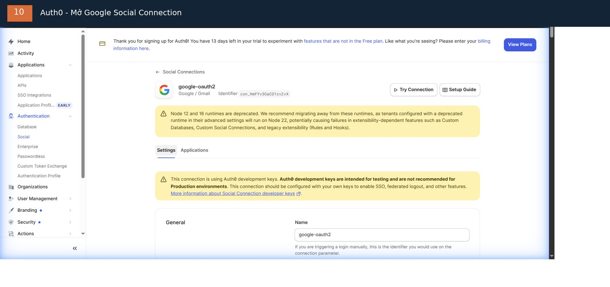

Ảnh dashboard hiện tại báo connection đang dùng **Auth0 development keys**. Đây chỉ dành cho thử nghiệm, không dùng cho production. Form Client ID và Client Secret đang để trống; không được để trống hai ô này khi triển khai production.

### Bước 4.2 — Tạo Google OAuth Client

Mở Google Cloud Console của project bạn sở hữu. Trong giao diện Google Auth Platform hiện tại:

1. Chọn **Google Auth Platform**.
2. Mở **Clients**.
3. Bấm **Create Client**.
4. Application type: chọn **Web application**.
5. Name: nhập ví dụ `Auth0 Google Login`.
6. Ở **Authorized redirect URIs**, bấm **Add URI**.
7. Quay lại Auth0 Google connection, bấm **Setup guide** để xem callback URL Auth0 cấp cho connection này. Sao chép đúng URL đó sang Authorized redirect URI trong Google Cloud.
8. Bấm **Create** trong Google Cloud.
9. Sao chép **Client ID** và **Client Secret** được cấp.

Redirect URI phải khớp tuyệt đối. Không tự gõ gần giống, không đổi `https` thành `http`, không bỏ path hoặc dấu `/`. Google từ chối URI không khớp.

Tài liệu chính thức: [Google OAuth 2.0 — Web Server Applications](https://developers.google.com/identity/protocols/oauth2/web-server) và [Auth0 Google Social Connection guide](https://developer.auth0.com/resources/labs/authentication/google-social-connection-to-login).

### Bước 4.3 — Dán Client ID và Client Secret vào Auth0

Quay lại Auth0 > Authentication > Social > google-oauth2 > Settings. Kéo xuống phần **General**.

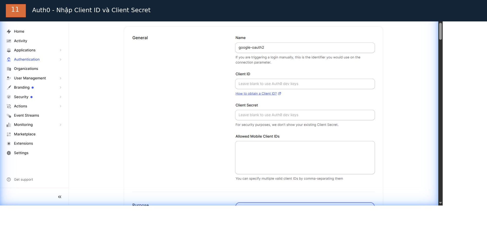

Điền:

| Ô Auth0 | Làm gì |
| --- | --- |
| **Name** | Giữ `google-oauth2` |
| **Client ID** | Dán Client ID vừa tạo ở Google Cloud |
| **Client Secret** | Dán Client Secret vừa tạo ở Google Cloud |
| **Allowed Mobile Client IDs** | Để trống nếu không dùng mobile client riêng |
| **Purpose** | Chọn `Authentication` để dùng Google làm đăng nhập |

Kéo xuống cuối trang và bấm **Save Changes**. Trong trang hiện tại, **Authentication** là lựa chọn đã được chọn. Giữ nguyên nếu connection này dùng để đăng nhập; không chọn Connected Accounts trừ khi triển khai Token Vault có chủ đích.

Không dán Client Secret vào tài liệu, Git, ảnh chụp, chat hoặc terminal. Nếu secret từng bị lộ, thu hồi ở Google Cloud và tạo secret mới.

---

## 5. Auth0: kiểm tra Post-Login Action

Action chạy sau khi người dùng đăng nhập thành công và trước khi Auth0 phát token.

### Bước 5.1 — Mở Post Login trigger

1. Menu trái: mở **Actions**.
2. Chọn **Triggers**.
3. Trong phần **Sign Up & Login**, mở trigger **post-login**.

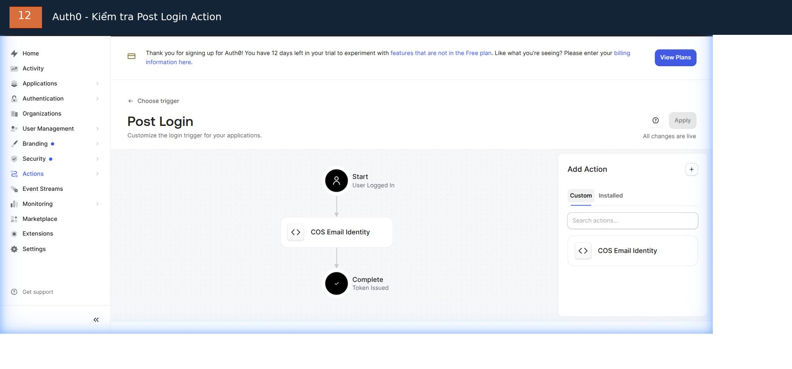

Trong tenant đang mở, Action `COS Email Identity` đã nằm giữa **Start** và **Complete**. Nút **Apply** đang disabled và trang ghi **All changes are live**. Nghĩa là Action đã được gắn; không kéo thả thêm lần nữa và không cần bấm Apply.

### Bước 5.2 — Kiểm tra Action đang chạy trong tenant này

1. Bấm tên **COS Email Identity** trên flow.
2. Trong trang Action, kiểm tra dòng trạng thái **Action is up to date**.
3. Mở tab **Secrets** ở thanh công cụ bên trái.

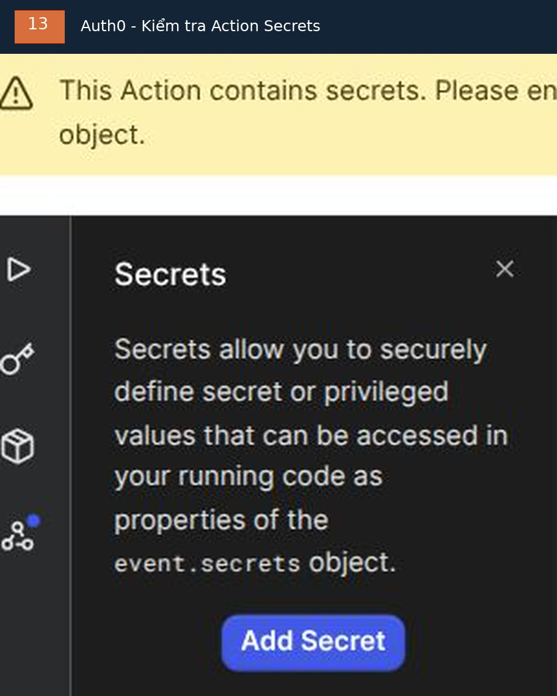

Trong tenant đang minh họa, **Secrets panel không có secret nào**. Đây là trạng thái đúng với code hiện tại: Action dùng hai giá trị hard-code trong mã nguồn, không đọc `event.secrets`. Vì vậy:

| Giá trị trong Action code | Giá trị hiện tại |
| --- | --- |
| `expectedResource` | Identifier/`resource` chính xác của Virtual Server, lấy ở bước 3.2 |
| URI truyền vào `api.accessToken.setCustomClaim(...)` | `https://bougainvillea.dpdns.org/email` |

Code kiểm tra `event.resource_server?.identifier`, chỉ chạy với đúng MCP API, từ chối email chưa xác minh và phát custom email claim. Giá trị `MCP_OAUTH_EMAIL_CLAIM` trong `.env` phải đúng bằng URI claim ở bảng trên.

**Không thêm** `MCP_RESOURCE_IDENTIFIER` hoặc `MCP_EMAIL_CLAIM` vào Secrets của Action đang chạy này. Nếu đổi Virtual Server, hostname hoặc claim URI, phải cập nhật các chuỗi tương ứng trong code Action và `.env` cùng một lần, rồi review/test trước khi Deploy. Action hiện có một nhánh alias được giới hạn cho một Google identity đã provision; đây là ngoại lệ riêng của tenant, không sao chép email hoặc subject cụ thể vào tài liệu dùng chung và không mở rộng ngoại lệ cho người khác.

### Bước 5.3 — Tạo Action mới cho một tenant khác (mẫu generic)

Chỉ làm phần này khi dựng tenant mới và quyết định dùng **mẫu generic có Action secrets** trong [oauth-setup.md](oauth-setup.md#3-add-a-post-login-action). Không làm phần này để sửa tenant đang minh họa:

1. Tại **Actions > Triggers > post-login**, phần **Add Action**, bấm **Create Action**.
2. Chọn **Build from scratch**.
3. Name: `COS Email Identity`.
4. Trigger: `Login / Post Login`.
5. Tạo Action và dùng code generic trong `oauth-setup.md`; code này phải đọc `event.secrets.MCP_RESOURCE_IDENTIFIER` và `event.secrets.MCP_EMAIL_CLAIM`.
6. Trong Action editor, mở **Secrets** rồi bấm **Add Secret**. Thêm từng cặp:

| Secret name | Giá trị cần dán |
| --- | --- |
| `MCP_RESOURCE_IDENTIFIER` | `resource` chính xác lấy từ metadata ở bước 3.2 |
| `MCP_EMAIL_CLAIM` | URI custom claim bạn chọn, ví dụ `https://<domain-cua-ban>/claims/email` |

7. Xác nhận hai secret xuất hiện trong danh sách (Auth0 không hiện lại giá trị secret sau khi lưu).
8. Bấm **Deploy** trong Action editor.
9. Quay lại **Actions > Triggers > post-login**. Trong tab **Custom**, kéo Action mới vào flow giữa **Start** và **Complete**.
10. Bấm **Apply** nếu nút này được bật; xác nhận trang báo **All changes are live**.

Action phải chỉ chạy cho đúng MCP audience, từ chối nếu email thiếu hoặc chưa xác minh (`email_verified !== true`), rồi phát email dạng chữ thường trong custom claim. Không log token hoặc secret.

### Bước 5.4 — Đồng bộ claim với ContextForge

Với tenant đang minh họa, file `.env` của ContextForge phải có:

```dotenv
MCP_OAUTH_EMAIL_CLAIM=https://bougainvillea.dpdns.org/email
```

Với Action generic mới ở bước 5.3, đặt `MCP_OAUTH_EMAIL_CLAIM` bằng đúng giá trị đã lưu trong secret `MCP_EMAIL_CLAIM`:

```dotenv
MCP_OAUTH_EMAIL_CLAIM=https://<domain-cua-ban>/claims/email
```

Thay `<domain-cua-ban>` bằng domain bạn kiểm soát. Không giữ nguyên ví dụ nếu chưa cấu hình đúng Action. Hai kiểu Action là hai cách triển khai thay thế nhau; không trộn code hard-code với hướng dẫn thêm secrets.

---

## 6. Kiểm tra trước khi nối ChatGPT

1. Cloudflare: Tunnel `cos-mcp` phải Healthy và hostname route phải trỏ tới đúng origin `http://127.0.0.1:4444`.
2. ContextForge: protected-resource metadata phải trả HTTP 200 và trường `resource` phải khớp Auth0 API Identifier.
3. Auth0: API dùng RS256, RFC 9068 và scope `mcp:connect`.
4. Auth0 Google connection: đã dùng Client ID/Secret do operator sở hữu; không còn dùng development keys cho production.
5. Auth0: Post Login có `COS Email Identity` và claim email được đồng bộ với `.env`.
6. ContextForge: từng người đã được provision thành local user đang active và được thêm vào team với role phù hợp.

Đăng nhập Google thành công chưa chứng minh MCP đã kiểm tra đúng audience, claim hoặc RBAC. Sau đó mới kết nối ChatGPT bằng HTTPS endpoint của Virtual Server và kiểm tra tool xuất hiện.

---

## 7. Tái chụp và xử lý ảnh

Ảnh chụp gốc không được lưu trong repository. Ảnh minh họa trong `docs/assets/` là bản đã xử lý bằng FFmpeg.

Đối với ảnh dashboard mới, dùng script:

```bash
bash docs/assets/process-dashboard-screenshots.sh \
  /path/to/auth0-apis-raw.jpg \
  /path/to/cloudflare-tunnels-raw.jpg \
  docs/assets
```

Script trên xử lý hai ảnh danh sách. Với ảnh từng form/step riêng, dùng FFmpeg tương tự để che header/email và đánh dấu vùng cần nhìn; không đưa Client Secret, bearer token, API key, tunnel token hoặc thông tin đăng nhập vào ảnh.

Để render lại sơ đồ, video và GIF:

```bash
bash docs/assets/render.sh
```
