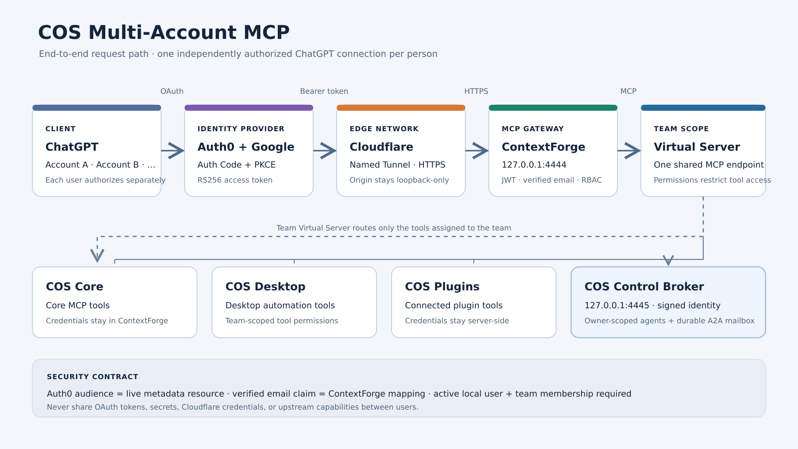
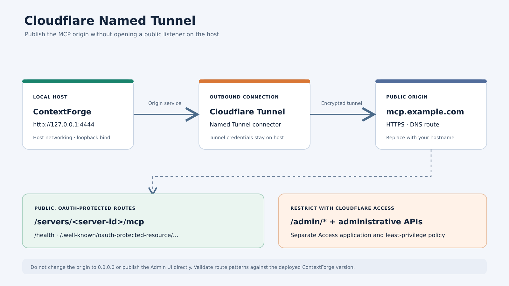
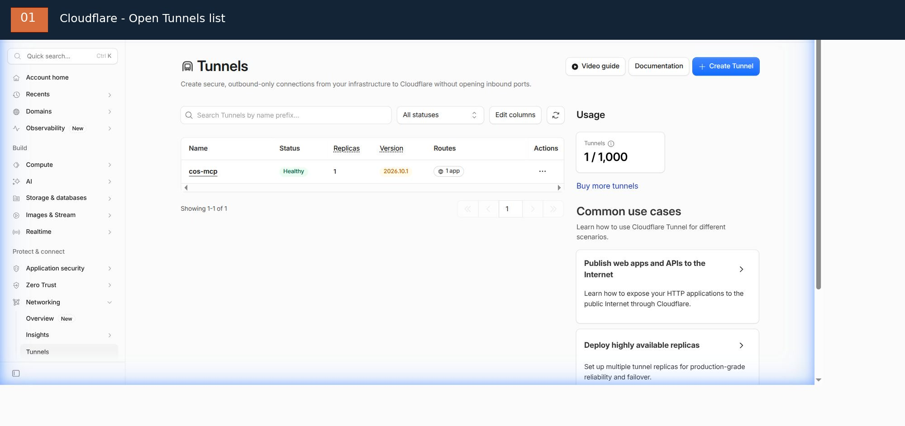
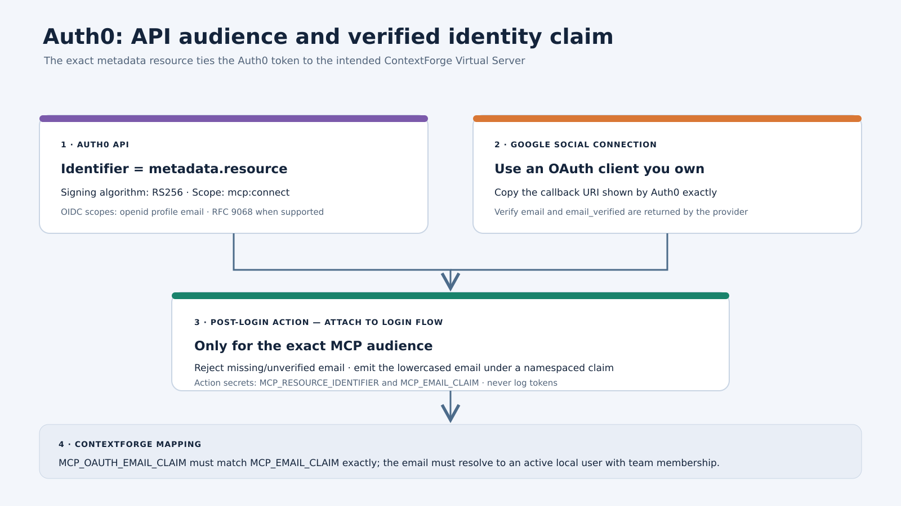

# COS Multi-Account MCP — operator runbook

> Language: English | [Tiếng Việt](deployment-guide.vi.md)

Repository: https://github.com/nplongx/cos-multi-account-mcp

Public Gist mirror: https://gist.github.com/nplongx/1f17336a782a99fb4d0d15181532a5b9

> **Supported client scope:** This repository and deployment runbook are intended only for [Chat on Steroids](https://github.com/totec448-spec/chat-on-steroids). This is the only client integration covered by the project's setup and acceptance work. Other MCP clients, desktop applications, agents, and automation systems have not been validated or confirmed; do not assume compatibility or support.

This runbook deploys one ContextForge MCP Virtual Server for a team. Each ChatGPT account used through Chat on Steroids authenticates independently using OAuth Authorization Code + PKCE. ContextForge validates the user's token, maps its verified email claim to an active local user, and enforces team membership/RBAC.

> Development/trial status: the original test used Auth0 development keys. Replace those before production. Complete the server-side token/email/RBAC acceptance checks before production use.

Start with the [end-to-end setup guide](getting-started.md). The diagrams and FFmpeg-rendered walkthrough are available there and in [`assets/`](assets/).

For a beginner-oriented, screenshot-by-screenshot walkthrough of the Auth0 and Cloudflare dashboards, see the [English walkthrough](dashboard-walkthrough.md) or the [Vietnamese walkthrough](dashboard-walkthrough.vi.md).



## 1. Understand the request path

```text
ChatGPT user A / user B / user C
           |
           | independent OAuth authorization + PKCE
           v
      Auth0 + Google
           |
           | RS256 access token for exact MCP resource
           v
    Cloudflare Named Tunnel
           |
           v
 ContextForge (loopback origin)
           |
           | verified email -> active local user -> team/RBAC
           v
 Team Virtual Server -> COS Core / Desktop / Plugins
```

Do not share an access token, refresh token, OAuth client secret, or upstream capability credential between people.

## 2. Prepare the host

Requirements:

- Docker Engine and Docker Compose v2.
- A Linux host.
- A Cloudflare Named Tunnel and hostname under your control.
- An Auth0 tenant and a Google OAuth client you own.
- A persistent database volume.

Clone the repository:

```bash
git clone https://github.com/nplongx/cos-multi-account-mcp.git
cd cos-multi-account-mcp
```

Create a private environment file:

```bash
cp .env.example .env
chmod 600 .env
for name in JWT_SECRET_KEY AUTH_ENCRYPTION_SECRET COS_IDENTITY_HMAC_SECRET; do
  printf '%s=' "$name"
  openssl rand -hex 32
done
```

Copy each generated value into its matching variable. Keep `JWT_SECRET_KEY`, `AUTH_ENCRYPTION_SECRET`, and `COS_IDENTITY_HMAC_SECRET` distinct. Set unique admin and default-user passwords. Never put real values into GitHub, screenshots, issues, or this Gist.

Set `COS_CONTROL_API_TOKEN_HOST_PATH` to the broker-readable token copy, not to a token embedded in `.env`; follow [deployment.md](deployment.md#1-configure-secrets). The COS Control API must have `controlApi.enabled=true` and `controlApi.allowActions=true`.

Set `APP_DOMAIN` to the external HTTPS hostname and `MCP_OAUTH_EMAIL_CLAIM` to the claim URI that Auth0 will issue.

## 3. Build and start ContextForge

```bash
docker volume create cos-contextforge-data
docker compose config -q
docker compose build
docker compose up -d
docker compose ps
docker compose logs --tail=100 contextforge
docker compose logs --tail=100 cos-control-broker
curl -fsS http://127.0.0.1:4444/health
curl -fsS http://127.0.0.1:4445/healthz
```

ContextForge must bind to `127.0.0.1:4444` and the broker to `127.0.0.1:4445`. Do not expose either port directly to the Internet.

## 4. Configure Cloudflare





Create a Named Tunnel route from your chosen hostname to:

```text
http://127.0.0.1:4444
```

Protect `/admin/*` and administrative APIs with Cloudflare Access. Keep Tunnel tokens, Access service tokens, and tunnel credentials on the host only.

The intended public surface includes health and protected-resource discovery plus the OAuth-protected MCP endpoint. Admin interfaces must stay behind Access.

## 5. Create the ContextForge team and Virtual Server

In the ContextForge admin interface:

1. Create the team.
2. Provision each explicitly approved person as an active local ContextForge user. For the current COS deployment, use the administrator-driven passwordless Auth0 procedure below; a Google/Auth0 signup does not create the local user.
3. Add each provisioned user to the team and assign least-privilege membership/RBAC (`member` for ordinary COS Multi-Account access).
4. Configure the COS Core, Desktop, and Plugins upstream MCP servers.
5. Create a Gateway named `cos-control-broker` with URL `http://127.0.0.1:4445/mcp` and Gateway mode `direct_proxy`. Keep signed identity propagation enabled.
6. Create one team-visible Virtual Server with OAuth enabled.
7. Attach only the intended upstream servers and `cos-control-broker` Gateway to the Virtual Server. Grant intended team members `tools.read` and `tools.execute` permissions.
8. Retrieve its RFC 9728 protected-resource metadata.

The live metadata `resource` is the canonical OAuth audience. Copy it exactly. Do not use an old URL or guess the Server ID.

### Administrator-driven Gmail provisioning (current deployment)

There are three separate layers: Auth0 + Google authenticates the person; the ContextForge local user stores the account; membership in `COS Multi-Account` grants team access. Google signup/login alone does not provision the local user or membership.

For each explicitly approved address, call `EmailAuthService.create_sso_user(email=..., auth_provider="auth0", is_admin=False, is_active=True, granted_by=...)`, then `TeamManagementService.add_member_to_team(team_id=..., user_email=..., role="member", invited_by=..., grant_source="manual")`.

The enabled `auth0` provider record is a prerequisite. Current deployment has `auto_create_users=false` and global `sso_enabled=false`; the admin service method remains usable and is intentionally separate from JIT. It bypasses JIT auto-create, trusted-domain, and approval checks, so only provision addresses with explicit approval. Created accounts are passwordless, active, non-admin, and initially `email_verified=false`; normal onboarding creates a personal team and configured default roles. Do not manually mark an email verified, duplicate personal teams, or use `viewer` as the membership role (`TeamManagementService` accepts `owner` and `member`).

Do not use `SSOService.authenticate_or_create_user()` as the manual account-creation method, do not enable global SSO just to add users, and do not create a replacement Auth0 application. The REST `POST /v1/admin/users/sso` route is conditional on global SSO and is not the current provisioning path. Use the [full Gmail provisioning runbook](https://github.com/nplongx/cos-multi-account-mcp/blob/main/docs/sso-user-provisioning.md) for the dry-run-first script, idempotency behavior, and post-provisioning checks.

## 6. Configure Auth0



Create an Auth0 API:

- Identifier: exact metadata `resource`;
- signing algorithm: RS256;
- access-token profile: RFC 9068, where supported;
- required scope: `mcp:connect`;
- user identity scopes: `openid profile email`.

Enable the Resource Parameter Compatibility Profile when required by the client integration.

Configure Google social login with an OAuth client you own. Do not use Auth0 development keys for production. Review whether the Google connection is available to every third-party application in the tenant.

Add a Post-Login Action that:

1. runs only for the exact MCP audience;
2. rejects missing or unverified email;
3. emits the verified email under a namespaced custom claim;
4. does not log or disclose tokens.

Use the same claim URI in the Action and ContextForge's `MCP_OAUTH_EMAIL_CLAIM` setting.

Example:

```javascript
exports.onExecutePostLogin = async (event, api) => {
  const expectedAudience = event.secrets.MCP_RESOURCE_IDENTIFIER;
  const claimName = event.secrets.MCP_EMAIL_CLAIM;

  if (event.resource_server?.identifier !== expectedAudience) return;

  const email = event.user?.email;
  if (!email || event.user?.email_verified !== true) {
    api.access.deny("A verified email address is required.");
    return;
  }

  api.accessToken.setCustomClaim(claimName, email.toLowerCase());
};
```

Set Action secrets `MCP_RESOURCE_IDENTIFIER` and `MCP_EMAIL_CLAIM` in Auth0. Adapt this sample to the actual event schema and test it in a non-production tenant first.

Do not enable `offline_access` until refresh-token storage, rotation, revocation, and recovery are designed and verified.

## 7. Connect ChatGPT

For each user separately:

1. Use a ChatGPT plan/workspace that permits the required custom MCP connection.
2. Add the HTTPS endpoint: `https://<hostname>/servers/<server-id>/mcp`.
3. Select OAuth.
4. Complete the Auth0 redirect and choose the correct Google account.
5. Verify the expected tools are listed.

Use the dynamic client metadata and redirect URI generated by ChatGPT. Do not hard-code a callback URL. Never export a token from one user's connection to another.

## 8. Verify the security contract

Health:

```bash
curl -i http://127.0.0.1:4444/health
```

Protected-resource discovery:

```text
https://<hostname>/.well-known/oauth-protected-resource/servers/<server-id>/mcp
```

Negative unauthenticated test: POST to the MCP endpoint without a bearer token. Expected result: HTTP 401 with a `WWW-Authenticate` resource-metadata challenge.

For an authenticated test, verify server-side that the token has:

- the expected Auth0 issuer;
- the exact ContextForge resource audience;
- valid expiry and required `mcp:connect` scope;
- a verified custom email claim.

Then verify ContextForge resolves that email to the intended active user and applies team RBAC. Verify a disabled user and a non-member are denied.

Never paste a real token into a shell command, issue, Gist, screenshot, or chat log.

## 9. Operations and recovery

Inspect:

```bash
docker compose ps
docker compose logs --tail=200 contextforge
```

Back up the database volume before upgrades. Keep backups encrypted and outside the repository. Do not use `docker compose down -v` for routine restarts; the volume contains identity and server configuration state.

If any credential leaks, revoke/rotate it at the issuer, review audit logs, and re-authorize affected users. Deleting the file from the latest commit does not remove it from Git history.

## 10. Acceptance status

The initial setup observed health HTTP 200, RFC 9728 metadata HTTP 200, and unauthenticated MCP HTTP 401. One Google/Auth0 login and authorization-code exchange was observed. A complete server-side proof of ChatGPT token -> custom email claim -> ContextForge team/RBAC remains an acceptance gate.

Production gates:

- replace Auth0 trial tenant and Google development keys;
- review third-party OAuth exposure;
- verify real ChatGPT token audience, scope, and email claim;
- verify member, non-member, and disabled-user authorization;
- test backup/restore and credential rotation.

Version-controlled docs and source: https://github.com/nplongx/cos-multi-account-mcp
