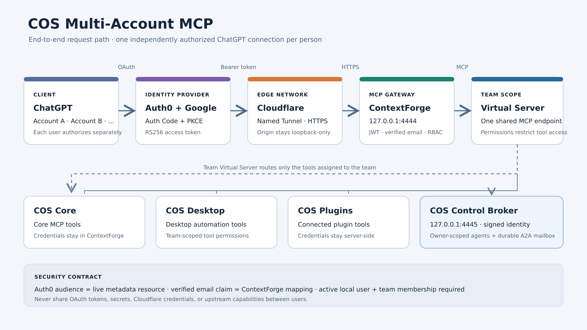
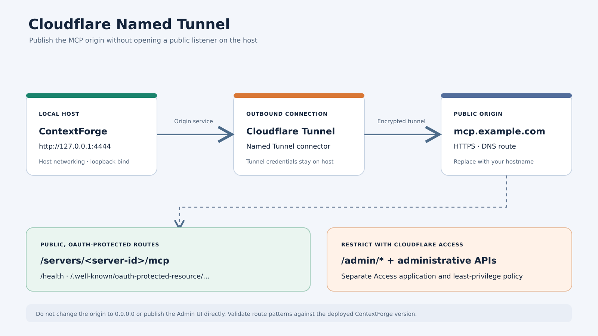
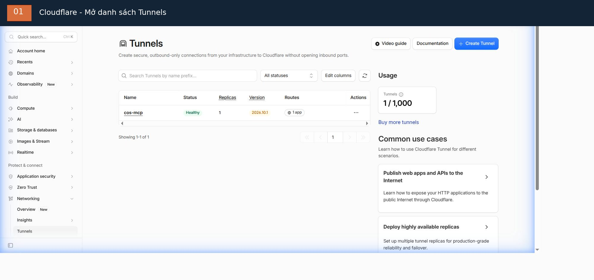
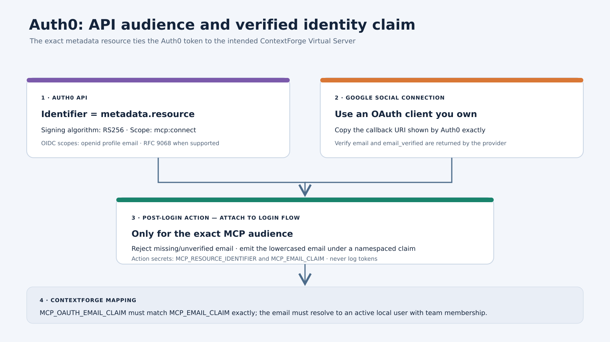

# COS Multi-Account MCP — operator runbook

> Ngôn ngữ: [English](deployment-guide.md) | Tiếng Việt

Repository: https://github.com/nplongx/cos-multi-account-mcp

Runbook này triển khai một ContextForge MCP Virtual Server cho một team. Mỗi ChatGPT account tự xác thực bằng OAuth Authorization Code + PKCE. ContextForge xác minh token của user, ánh xạ email claim đã xác minh tới local user active và thực thi team membership/RBAC.

> Trạng thái development/trial: lần test ban đầu dùng Auth0 development keys. Thay chúng trước production. Hoàn tất token/email/RBAC acceptance check phía server trước khi sử dụng production.

Bắt đầu với [hướng dẫn setup end-to-end](getting-started.vi.md). Sơ đồ và walkthrough render bằng FFmpeg có trong tài liệu đó và thư mục [`assets/`](assets/).

Với người mới, xem [dashboard walkthrough từng ảnh bằng tiếng Việt](dashboard-walkthrough.vi.md) cho các trang Auth0 và Cloudflare.



## 1. Hiểu đường đi của request

```text
ChatGPT user A / user B / user C
           |
           | independent OAuth authorization + PKCE
           v
      Auth0 + Google
           |
           | RS256 access token for exact MCP resource
           v
    Cloudflare Named Tunnel
           |
           v
 ContextForge (loopback origin)
           |
           | verified email -> active local user -> team/RBAC
           v
 Team Virtual Server -> COS Core / Desktop / Plugins
```

Không chia sẻ access token, refresh token, OAuth client secret hoặc upstream capability credential giữa nhiều người.

## 2. Chuẩn bị host

Yêu cầu:

- Docker Engine và Docker Compose v2.
- Linux host.
- Cloudflare Named Tunnel và hostname thuộc quyền kiểm soát của bạn.
- Auth0 tenant và Google OAuth client do bạn sở hữu.
- Persistent database volume.

Clone repository:

```bash
git clone https://github.com/nplongx/cos-multi-account-mcp.git
cd cos-multi-account-mcp
```

Tạo environment file riêng tư:

```bash
cp .env.example .env
chmod 600 .env
for name in JWT_SECRET_KEY AUTH_ENCRYPTION_SECRET COS_IDENTITY_HMAC_SECRET; do
  printf '%s=' "$name"
  openssl rand -hex 32
done
```

Copy từng giá trị sinh ra vào đúng biến tương ứng. Giữ `JWT_SECRET_KEY`, `AUTH_ENCRYPTION_SECRET` và `COS_IDENTITY_HMAC_SECRET` khác nhau. Đặt mật khẩu admin và default user riêng biệt. Không bao giờ đưa giá trị thật vào GitHub, screenshot, issue hoặc Gist.

Đặt `COS_CONTROL_API_TOKEN_HOST_PATH` trỏ tới bản token copy mà broker có thể đọc, không phải token nhúng trong `.env`; xem [deployment.vi.md](deployment.vi.md#1-cấu-hình-secret). COS Control API phải có `controlApi.enabled=true` và `controlApi.allowActions=true`.

Đặt `APP_DOMAIN` thành HTTPS hostname public và `MCP_OAUTH_EMAIL_CLAIM` thành claim URI mà Auth0 sẽ phát ra.

## 3. Build và khởi động ContextForge

```bash
docker volume create cos-contextforge-data
docker compose config -q
docker compose build
docker compose up -d
docker compose ps
docker compose logs --tail=100 contextforge
docker compose logs --tail=100 cos-control-broker
curl -fsS http://127.0.0.1:4444/health
curl -fsS http://127.0.0.1:4445/healthz
```

ContextForge phải bind `127.0.0.1:4444`, broker phải bind `127.0.0.1:4445`. Không expose trực tiếp hai port này ra Internet.

## 4. Cấu hình Cloudflare





Tạo Named Tunnel route từ hostname đã chọn tới:

```text
http://127.0.0.1:4444
```

Bảo vệ `/admin/*` và administrative API bằng Cloudflare Access. Chỉ giữ Tunnel token, Access service token và tunnel credential trên host.

Bề mặt public dự kiến gồm health, protected-resource discovery và OAuth-protected MCP endpoint. Admin interface phải luôn ở phía sau Access.

## 5. Tạo ContextForge team và Virtual Server

Trong ContextForge admin interface:

1. Tạo team.
2. Provision từng người được phê duyệt rõ ràng thành ContextForge local user active. Với COS deployment hiện tại, dùng quy trình Auth0 không password do administrator thực hiện bên dưới; Google/Auth0 signup không tự tạo local user.
3. Thêm từng user đã provision vào team và gán membership/RBAC least-privilege (`member` cho quyền COS Multi-Account thông thường).
4. Cấu hình COS Core, Desktop và Plugins upstream MCP server.
5. Tạo Gateway tên `cos-control-broker` với URL `http://127.0.0.1:4445/mcp` và Gateway mode `direct_proxy`. Giữ signed identity propagation bật.
6. Tạo một team-visible Virtual Server có bật OAuth.
7. Chỉ attach upstream server dự kiến và Gateway `cos-control-broker` vào Virtual Server. Cấp cho team member dự kiến quyền `tools.read` và `tools.execute`.
8. Lấy RFC 9728 protected-resource metadata.

`resource` trong live metadata là OAuth audience chuẩn. Copy chính xác. Không dùng URL cũ hoặc đoán Server ID.

### Provision Gmail do administrator thực hiện (deployment hiện tại)

Có ba lớp tách biệt: Auth0 + Google xác thực người dùng; ContextForge local user lưu account; membership trong `COS Multi-Account` cấp quyền truy cập team. Google signup/login riêng lẻ không provision local user hoặc membership.

Với từng địa chỉ được phê duyệt rõ ràng, gọi `EmailAuthService.create_sso_user(email=..., auth_provider="auth0", is_admin=False, is_active=True, granted_by=...)`, sau đó `TeamManagementService.add_member_to_team(team_id=..., user_email=..., role="member", invited_by=..., grant_source="manual")`.

Enabled `auth0` provider record là điều kiện tiên quyết. Deployment hiện tại có `auto_create_users=false` và global `sso_enabled=false`; admin service method vẫn dùng được và cố ý tách khỏi JIT. Nó bypass auto-create, trusted-domain và approval check của JIT, vì vậy chỉ provision địa chỉ đã được phê duyệt rõ ràng. Account tạo ra là passwordless, active, non-admin và ban đầu có `email_verified=false`; onboarding thông thường tạo personal team cùng default role. Không tự đánh dấu email verified, tạo personal team trùng hoặc dùng `viewer` làm membership role (`TeamManagementService` chỉ chấp nhận `owner` và `member`).

Không dùng `SSOService.authenticate_or_create_user()` làm phương thức tạo account thủ công, không bật global SSO chỉ để thêm user và không tạo Auth0 application thay thế. REST `POST /v1/admin/users/sso` phụ thuộc global SSO và không phải provisioning path hiện tại. Dùng [runbook Gmail provisioning đầy đủ](sso-user-provisioning.vi.md) để có dry-run-first script, idempotency behavior và post-provisioning check.

## 6. Cấu hình Auth0



Tạo Auth0 API:

- Identifier: metadata `resource` chính xác;
- signing algorithm: RS256;
- access-token profile: RFC 9068, nếu hỗ trợ;
- scope bắt buộc: `mcp:connect`;
- user identity scope: `openid profile email`.

Bật Resource Parameter Compatibility Profile khi client integration yêu cầu.

Cấu hình Google social login bằng OAuth client do bạn sở hữu. Không dùng Auth0 development key cho production. Rà soát Google connection có được bật cho mọi third-party application trong tenant hay không.

Thêm Post-Login Action:

1. Chỉ chạy với đúng MCP audience.
2. Từ chối nếu thiếu email hoặc email chưa xác minh.
3. Phát email đã xác minh dưới namespaced custom claim.
4. Không log hoặc tiết lộ token.

Dùng cùng claim URI trong Action và setting `MCP_OAUTH_EMAIL_CLAIM` của ContextForge.

Ví dụ:

```javascript
exports.onExecutePostLogin = async (event, api) => {
  const expectedAudience = event.secrets.MCP_RESOURCE_IDENTIFIER;
  const claimName = event.secrets.MCP_EMAIL_CLAIM;

  if (event.resource_server?.identifier !== expectedAudience) return;

  const email = event.user?.email;
  if (!email || event.user?.email_verified !== true) {
    api.access.deny("A verified email address is required.");
    return;
  }

  api.accessToken.setCustomClaim(claimName, email.toLowerCase());
};
```

Đặt Action secret `MCP_RESOURCE_IDENTIFIER` và `MCP_EMAIL_CLAIM` trong Auth0. Điều chỉnh sample theo event schema thực tế và kiểm thử trước trong non-production tenant.

Không bật `offline_access` cho tới khi refresh-token storage, rotation, revocation và recovery được thiết kế và xác minh.

## 7. Kết nối ChatGPT

Với từng user riêng biệt:

1. Dùng ChatGPT plan/workspace cho phép custom MCP connection cần thiết.
2. Thêm HTTPS endpoint: `https://<hostname>/servers/<server-id>/mcp`.
3. Chọn OAuth.
4. Hoàn tất Auth0 redirect và chọn đúng Google account.
5. Xác minh các tool dự kiến được liệt kê.

Dùng dynamic client metadata và redirect URI do ChatGPT sinh ra. Không hard-code callback URL. Không export token từ connection của user này sang user khác.

## 8. Xác minh hợp đồng bảo mật

Health:

```bash
curl -i http://127.0.0.1:4444/health
```

Protected-resource discovery:

```text
https://<hostname>/.well-known/oauth-protected-resource/servers/<server-id>/mcp
```

Negative unauthenticated test: POST tới MCP endpoint không có bearer token. Kết quả mong đợi: HTTP 401 với `WWW-Authenticate` resource-metadata challenge.

Với test đã xác thực, xác minh phía server token có:

- Auth0 issuer dự kiến;
- ContextForge resource audience chính xác;
- expiry hợp lệ và scope `mcp:connect` bắt buộc;
- custom email claim đã xác minh.

Sau đó xác minh ContextForge resolve email tới đúng user active và áp dụng team RBAC. Xác minh user disabled và non-member đều bị từ chối.

Không bao giờ dán token thật vào shell command, issue, Gist, screenshot hoặc chat log.

## 9. Vận hành và recovery

Kiểm tra:

```bash
docker compose ps
docker compose logs --tail=200 contextforge
```

Backup database volume trước khi upgrade. Giữ backup được mã hóa và ngoài repository. Không dùng `docker compose down -v` để restart thông thường; volume chứa identity và server configuration state.

Nếu credential bị lộ, thu hồi/xoay nó tại issuer, review audit log và authorize lại user bị ảnh hưởng. Xóa file khỏi commit mới nhất không xóa nó khỏi Git history.

## 10. Trạng thái nghiệm thu

Setup ban đầu quan sát được health HTTP 200, RFC 9728 metadata HTTP 200 và unauthenticated MCP HTTP 401. Một Google/Auth0 login và authorization-code exchange đã được quan sát. Bằng chứng server-side đầy đủ ChatGPT token -> custom email claim -> ContextForge team/RBAC vẫn là acceptance gate.

Production gate:

- thay Auth0 trial tenant và Google development key;
- rà soát third-party OAuth exposure;
- xác minh audience, scope và email claim của ChatGPT token thật;
- xác minh quyền member, non-member và disabled user;
- kiểm thử backup/restore và credential rotation.

Tài liệu và source được version-control: https://github.com/nplongx/cos-multi-account-mcp
