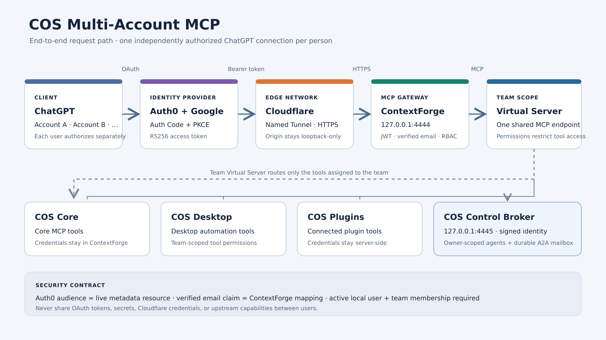
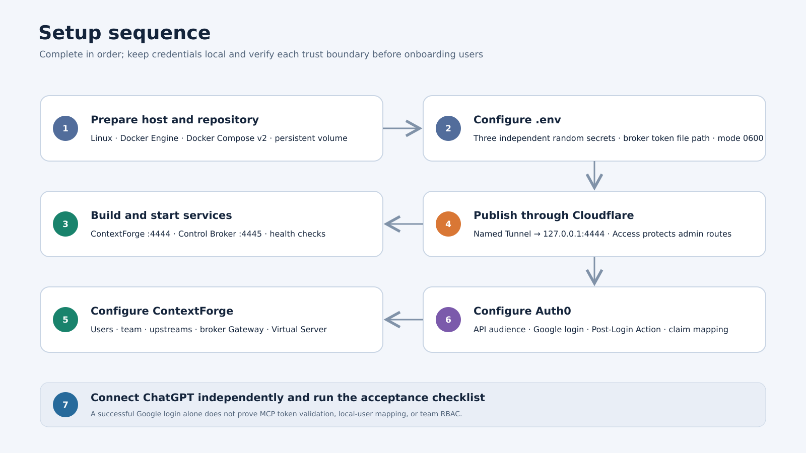
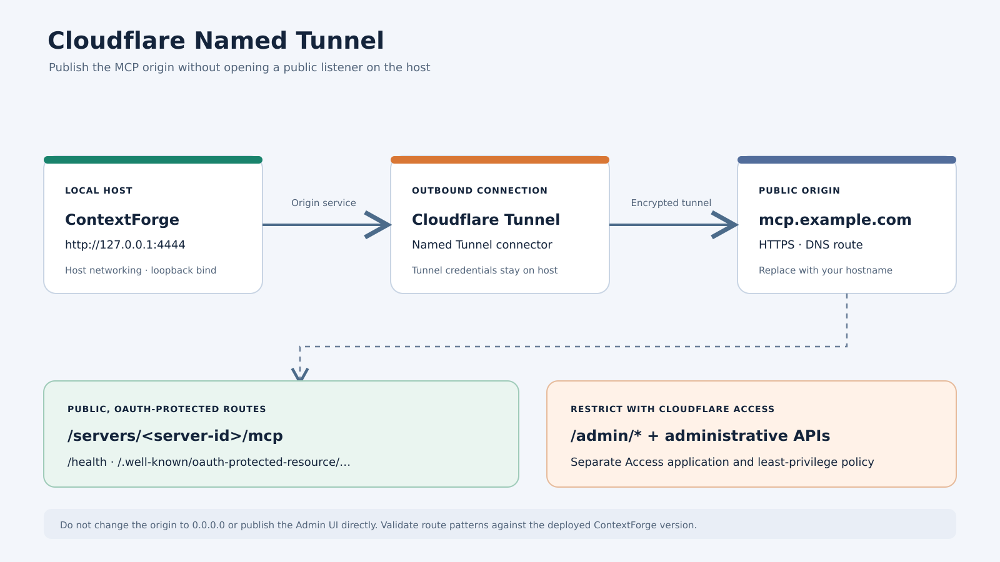
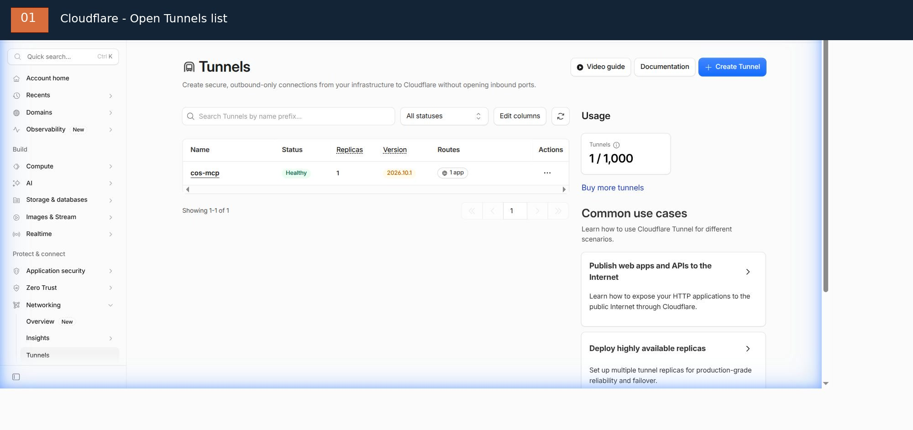
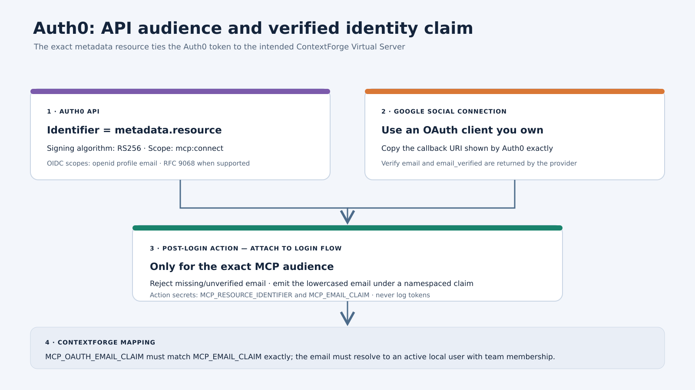
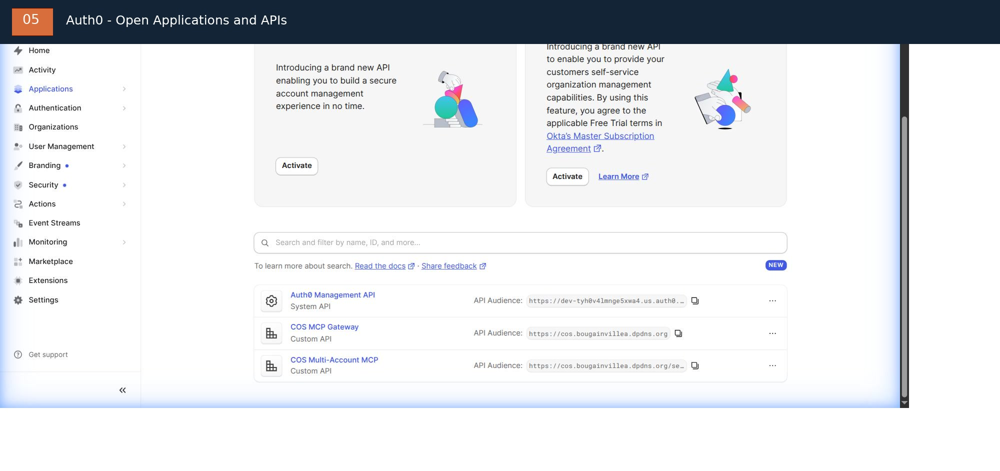

# COS Multi-Account MCP — setup guide

> Language: English | [Tiếng Việt](getting-started.vi.md)

**Repository:** https://github.com/nplongx/cos-multi-account-mcp
**Operator runbook:** [deployment-guide.md](deployment-guide.md)
**Older public Gist copy:** https://gist.github.com/nplongx/1f17336a782a99fb4d0d15181532a5b9

This guide covers host preparation, deployment, OAuth setup, ChatGPT connection, and security checks. The repository's `docs/` directory is the version-controlled source of truth; the older public Gist is a convenience copy and may lag behind this file.

> **New to Auth0 or Cloudflare?** Follow the [step-by-step dashboard walkthrough in English](dashboard-walkthrough.md) or [Vietnamese](dashboard-walkthrough.vi.md). It shows where to click, what to enter, and which existing settings must only be checked rather than recreated.

> **Status: development / trial.** Initial deployment checks passed, but the complete ChatGPT token → verified email claim → ContextForge team/RBAC path has not been accepted end to end. Do not treat this configuration as production-ready.

*Illustrative architecture diagram, not a live dashboard screenshot.* The short visual walkthrough is available as [MP4](assets/setup-walkthrough.mp4) or [animated GIF](assets/setup-walkthrough.gif). Source diagrams are editable SVG files; regenerate all media with `bash docs/assets/render.sh` (requires FFmpeg with the `librsvg` decoder).

## 1. Architecture

~~~text
ChatGPT client -- OAuth Authorization Code + PKCE --> Auth0 + Google
      |
      | HTTPS MCP request + per-user bearer token
      v
Cloudflare Named Tunnel --> ContextForge (127.0.0.1:4444)
                                  |
                                  | validate issuer/audience/scope/email claim
                                  v
                         active local user + team RBAC
                                  |
                                  v
                      Team Virtual Server + tool ACLs
                         |       |       |       |
                      Core   Desktop  Plugins  Broker (:4445)
                                                  |
                                          Local Control API + A2A mailbox
~~~

Each person authorizes their own ChatGPT connection. Never share access tokens, refresh tokens, OAuth client secrets, tunnel credentials, or upstream capability credentials.

## 2. Prerequisites

Prepare a Linux host with Docker Engine and Docker Compose v2, a Cloudflare account with a Named Tunnel and a hostname you control, an Auth0 tenant, a Google OAuth client you own, and administrator access to ContextForge and the COS Control API.

Check Docker:

~~~bash
docker version
docker compose version
~~~

The deployment uses host networking and loopback listeners on `127.0.0.1:4444` (ContextForge) and `127.0.0.1:4445` (COS Control Broker). Do not expose either port directly to the Internet.

## 3. Clone and configure

~~~bash
git clone https://github.com/nplongx/cos-multi-account-mcp.git
cd cos-multi-account-mcp
cp .env.example .env
chmod 600 .env
~~~

Generate three independent secrets. Each command prints a different 32-byte random value; copy each value only into its matching `.env` variable:

~~~bash
for name in JWT_SECRET_KEY AUTH_ENCRYPTION_SECRET COS_IDENTITY_HMAC_SECRET; do
  printf '%s=' "$name"
  openssl rand -hex 32
done
~~~

Edit `.env`, replacing every placeholder. Keep `JWT_SECRET_KEY`, `AUTH_ENCRYPTION_SECRET`, and `COS_IDENTITY_HMAC_SECRET` independent. `COS_CONTROL_API_TOKEN_HOST_PATH` must point to the separate broker-readable token copy described in [deployment.md](deployment.md), not to a token pasted into `.env`.

| Variable | Required value |
| --- | --- |
| **APP_DOMAIN** | Public HTTPS origin, e.g. https://mcp.example.com |
| **MCP_OAUTH_EMAIL_CLAIM** | Exact namespaced claim URI emitted by Auth0 |
| **JWT_SECRET_KEY** | First random secret |
| **AUTH_ENCRYPTION_SECRET** | Second, different random secret |
| **COS_IDENTITY_HMAC_SECRET** | Third, different random secret; at least 32 bytes |
| **PLATFORM_ADMIN_EMAIL** | Operator's bootstrap admin email |
| **PLATFORM_ADMIN_PASSWORD** | Unique, strong bootstrap admin password |
| **PLATFORM_ADMIN_FULL_NAME** | Bootstrap admin display name |
| **DEFAULT_USER_PASSWORD** | Separate strong default-user password |
| **BASIC_AUTH_PASSWORD** | Separate strong Basic Auth password |
| **COS_CONTROL_API_URL** | Local COS Control API, normally `http://127.0.0.1:37121` |
| **COS_CONTROL_API_TOKEN_HOST_PATH** | Absolute host path to the broker-readable token file; see [deployment.md](deployment.md) |

The `COS_A2A_*` variables in `.env.example` are mailbox limits with defaults; change them only after reviewing broker quota behavior. Do not reuse passwords or secrets. Keep `.env` mode `0600`. Never put real values in `.env.example`, source code, GitHub issues, Gists, screenshots, or shell history.

The broker also requires COS Control API actions to be enabled (`controlApi.enabled=true` and `controlApi.allowActions=true`). Keep the original token at mode `0600`. Create the separate broker-readable copy at `/home/<user>/.config/chat-on-steroids/control-api/broker-token`, owned by the host operator and group `10001`, mode `0640`; point `COS_CONTROL_API_TOKEN_HOST_PATH` to that absolute path. Example:

~~~bash
install -o "$(id -u)" -g 10001 -m 0640 \
  "$HOME/.config/chat-on-steroids/control-api/token" \
  "$HOME/.config/chat-on-steroids/control-api/broker-token"
~~~

The broker mounts this file read-only. Never paste its contents into `.env`. See [deployment.md](deployment.md#1-configure-secrets) for the deployment contract.

## 4. Build and start

Create the persistent volume once:

~~~bash
docker volume create cos-contextforge-data
docker compose config -q
docker compose build
docker compose up -d
docker compose ps
docker compose logs --tail=100 contextforge
docker compose logs --tail=100 cos-control-broker
~~~

Verify both local health endpoints:

~~~bash
curl -fsS http://127.0.0.1:4444/health
curl -fsS http://127.0.0.1:4445/healthz
~~~

Compose binds ContextForge to `127.0.0.1:4444` and the broker to `127.0.0.1:4445` using host networking. Keep both listeners loopback-only. The external `cos-contextforge-data` volume stores gateway state; the broker has its own `cos-agent-broker-data` volume. Do not use `docker compose down -v` for routine restarts.

## 5. Configure Cloudflare Tunnel

The screenshot is a point-in-time view of the existing `cos-mcp` tunnel. It shows its observed status and route count; it does not prove that the route targets the intended origin. Open the tunnel and verify the public hostname and service URL separately.

Create or reuse a **Named Tunnel** and add a public-hostname route:

| Setting | Value |
| --- | --- |
| Hostname | Your MCP hostname |
| Service | HTTP |
| Origin URL | http://127.0.0.1:4444 |

Confirm the hostname DNS route is active. Set `APP_DOMAIN` to the matching HTTPS origin and restart:

~~~bash
docker compose up -d
~~~

Protect the ContextForge Admin UI and administrative APIs with a separate Cloudflare Access application and least-privilege policy. Verify actual route patterns against the deployed ContextForge version; do not assume that the MCP hostname automatically protects administrative routes. Keep Tunnel credentials and Access service tokens on the host only. The public surface should be limited to health, protected-resource discovery, and the OAuth-protected MCP endpoint.

## 6. Bootstrap ContextForge

Through the protected ContextForge Admin UI:

1. Sign in with the bootstrap administrator from .env; change bootstrap/default credentials immediately.
2. Create the `COS Multi-Account` team (or confirm the intended existing team).
3. Provision each explicitly approved person as an active local ContextForge user. For this deployment, use the administrator-driven passwordless Auth0 procedure below; Google/Auth0 signup by itself does not create a local ContextForge user.
4. Add each provisioned user to the team with the least-privilege membership role (`member` for ordinary COS Multi-Account access).
5. Configure COS Core, COS Desktop, and COS Plugins as upstream MCP servers. Store upstream credentials only in ContextForge.
6. Create a Gateway named `cos-control-broker` with URL `http://127.0.0.1:4445/mcp` and mode `direct_proxy`. Compose enables signed identity propagation; do not disable it for this Gateway.
7. Create a team-visible Virtual Server and enable OAuth.
8. Attach only the intended upstream servers and `cos-control-broker` Gateway to the Virtual Server. Grant intended team members the required `tools.read` and `tools.execute` permissions.
9. Record the Virtual Server's live server ID.
10. Retrieve its RFC 9728 protected-resource metadata.

Fetch its protected-resource metadata:

~~~bash
curl -fsS \
  "https://<hostname>/.well-known/oauth-protected-resource/servers/<server-id>/mcp"
~~~

The metadata `resource` value is the canonical OAuth audience. Copy it exactly, including path and trailing-slash behavior. Never guess the server ID or reuse a stale resource URL. A Gateway refresh by itself does not add tools to the Virtual Server; attach the imported tools to the Virtual Server separately. See [deployment.md](deployment.md#refresh-the-gateway-catalog-after-broker-tool-changes) for the refresh sequence.

### Provision Gmail users for the current COS deployment

Keep these identities separate:

- **Auth0 + Google login** authenticates the Google identity.
- **ContextForge local user** stores the active account and authorization state.
- **COS Multi-Account membership** grants access to the team Virtual Server.

For the current deployment, provision an explicitly approved Gmail address with `EmailAuthService.create_sso_user(email=..., auth_provider="auth0", is_admin=False, is_active=True, granted_by=...)`, then add it to `COS Multi-Account` with `TeamManagementService.add_member_to_team(..., role="member", grant_source="manual")`.

Important: the enabled `auth0` provider record is required. Its `auto_create_users` setting is `false`, and global `sso_enabled` is currently `false`. The administrator service method is the intended path and deliberately bypasses JIT auto-create, trusted-domain, and approval checks, so use it only after explicit access approval. It creates a passwordless, non-admin account (`password_hash=NULL`, initially `email_verified=false`) and normal onboarding creates the personal team/default roles. Do not manually mark email verified, create another personal team, or use `viewer` as the COS membership role; the service accepts `owner` or `member`.

Do not use `SSOService.authenticate_or_create_user()` for manual provisioning, do not enable global SSO just to add a user, and do not create a replacement Auth0 application. The REST endpoint `POST /v1/admin/users/sso` is conditional on SSO being enabled and is not the current route. Follow the [complete Gmail provisioning runbook](https://github.com/nplongx/cos-multi-account-mcp/blob/main/docs/sso-user-provisioning.md), including its dry-run script and verification checklist.

## 7. Configure Auth0 and Google

### Auth0 API

The screenshot shows the `COS Multi-Account MCP` custom API entry in the development tenant. It is a navigation reference, not a configuration export. Open that API and compare its Identifier with the live ContextForge metadata `resource`; use exact value from your environment.

The two live dashboard screenshots were captured from the existing browser tabs and processed with FFmpeg. Raw captures are kept outside the repository. To process new captures without committing originals, run `bash docs/assets/process-dashboard-screenshots.sh /path/to/auth0-apis-raw.jpg /path/to/cloudflare-tunnels-raw.jpg docs/assets`.

Create an Auth0 API with:

- Identifier: exactly the metadata resource from the previous step;
- signing algorithm: RS256;
- required scope: mcp:connect;
- identity scopes: openid profile email;
- RFC 9068 access-token profile where supported;
- Resource Parameter Compatibility Profile enabled when required by the MCP client.

Do not configure client-credentials flow for ordinary user connections. Do not enable offline_access until refresh-token storage, rotation, revocation, and recovery have been designed and tested.

### Google login

Use a Google OAuth client owned by the operator. Configure its authorized redirect URI exactly as shown by Auth0. Replace Auth0 development keys before production. Review which third-party applications can use the Google social connection.

### Post-Login Action

The currently deployed Auth0 tenant already has `COS Email Identity` attached to Post Login. Its current code hard-codes the MCP resource Identifier and email claim URI; it does not read `MCP_RESOURCE_IDENTIFIER` or `MCP_EMAIL_CLAIM` from Action secrets. Do not follow the generic secret-creation instructions below without first choosing to migrate that Action to the parameterized template. For exact dashboard navigation and the two variants, see [dashboard-walkthrough.vi.md](dashboard-walkthrough.vi.md#5-auth0-kiểm-tra-post-login-action).

The Action must run only for the intended MCP API, reject missing or unverified email, and emit a namespaced custom claim.

The code below is a **generic parameterized example for a new tenant**, not a copy of the Action currently deployed in the illustrated tenant. It reads two Action secrets. The current tenant instead hard-codes its exact resource Identifier and claim URI in `COS Email Identity`; its Secrets panel is empty. See the dashboard walkthrough before changing an existing Action.

Illustrative generic logic:

~~~javascript
exports.onExecutePostLogin = async (event, api) => {
  const expectedAudience = event.secrets.MCP_RESOURCE_IDENTIFIER;
  const claimName = event.secrets.MCP_EMAIL_CLAIM;

  if (event.resource_server?.identifier !== expectedAudience) return;

  const email = event.user?.email;
  if (!email || event.user?.email_verified !== true) {
    api.access.deny("A verified email address is required.");
    return;
  }

  api.accessToken.setCustomClaim(claimName, email.toLowerCase());
};
~~~

Only when using the generic code above: in Auth0 Action editor > **Secrets** > **Add Secret**, create `MCP_RESOURCE_IDENTIFIER` with the exact API Identifier and `MCP_EMAIL_CLAIM` with your chosen namespaced claim URI. Confirm both names appear, adapt the sample to the tenant's event schema, test in a non-production tenant, deploy the Action, and attach it to the Login flow. Ensure the Action runs only for the intended MCP audience. Do not add these two secrets to the current hard-coded Action without first migrating its code.

For the current illustrated deployment, set ContextForge `MCP_OAUTH_EMAIL_CLAIM=https://bougainvillea.dpdns.org/email`, matching the existing Action. For a new generic deployment, set it to the same URI stored in `MCP_EMAIL_CLAIM`. The token email must resolve to an already-active ContextForge user. Do not silently provision unrestricted accounts from social login.

## 8. Connect each ChatGPT account

For each person separately:

1. Use an account/workspace that supports the required custom MCP connection.
2. Add `https://<hostname>/servers/<server-id>/mcp`.
3. Select OAuth authentication.
4. Complete the Auth0 redirect and sign in with the intended Google account.
5. Verify expected team tools appear.
6. Repeat independently for each authorized person.

Use OAuth client metadata and redirect URI generated by ChatGPT. Do not hard-code a callback URL from an old setup. Never export one user's token for another user.

## 9. Verify authentication and RBAC

- ContextForge health: `curl -i http://127.0.0.1:4444/health` — expect HTTP 200.
- Broker health: `curl -i http://127.0.0.1:4445/healthz` — expect HTTP 200.
- Public metadata: https://<hostname>/.well-known/oauth-protected-resource/servers/<server-id>/mcp — expect HTTP 200 and the exact resource identifier configured in Auth0.
- Unauthenticated MCP POST: send a request without an Authorization header — expect HTTP 401 with a WWW-Authenticate resource-metadata challenge.

For an authenticated test, verify server-side (without copying the bearer token into logs or terminals) that the token has the expected issuer, exact resource audience, valid expiry, mcp:connect scope, and verified namespaced email claim. Then verify ContextForge resolves the email to the intended active local user and enforces team RBAC.

Test an authorized member, a non-member, a disabled user, and tokens with wrong issuer/audience, expired `exp`, or missing `mcp:connect` scope. A successful Google login or authorization-code exchange alone does not prove gateway authentication or RBAC. Record the results in [verification.md](verification.md); do not mark production acceptance complete while any required check remains unproven.

## 10. Operations and backup

~~~bash
docker compose ps
docker compose logs --tail=200 contextforge
~~~

Before upgrades, stop the service and back up the named volume to encrypted storage outside the repository:

~~~bash
docker compose stop contextforge
docker run --rm \
  -v cos-contextforge-data:/data \
  -v "$PWD":/backup \
  alpine tar -czf /backup/contextforge-data-backup.tgz -C /data .
docker compose up -d
~~~

The backup contains identity and server configuration data. Encrypt it, restrict access, and never commit it. Do not use docker compose down -v for routine restarts; it can remove persistent state.

## 11. Troubleshooting

| Symptom | Checks |
| --- | --- |
| Container fails | docker compose logs --tail=200 contextforge; verify required .env values |
| Health check fails | Check container state and listeners on 127.0.0.1:4444 and 127.0.0.1:4445 |
| Public hostname unavailable | Check Tunnel route, DNS, origin URL, and Cloudflare |
| OAuth audience mismatch | Compare Auth0 API Identifier and metadata resource byte-for-byte |
| Email claim missing | Check Action trigger/secrets, verified email, and exact claim URI |
| User authenticated but denied | Check local account status, team membership, role, and Virtual Server visibility |
| Tools missing | Check Gateway health, refresh the Gateway catalog, attach tools to the team Virtual Server, and verify `tools.read` / `tools.execute` permissions |

If a credential leaks, revoke/rotate it at the issuer, review logs, and re-authorize affected users. Deleting a secret from the latest commit does not remove it from Git history.

## 12. Security and production gates

Before production:

- replace development/trial OAuth credentials with owned production credentials;
- review Cloudflare Access coverage for Admin UI and administrative APIs;
- verify issuer, audience, scope, email claim, and expiry server-side;
- verify active-member, non-member, disabled-user, and invalid-token behavior;
- test backup restoration and credential rotation;
- review ContextForge updates and rebuild the pinned image deliberately;
- keep secrets, database files, backups, and tunnel credentials outside Git.

Initial setup evidence included health HTTP 200, protected-resource metadata HTTP 200, unauthenticated MCP HTTP 401, and one observed Google/Auth0 authorization-code exchange. Full ChatGPT-issued token → custom email claim → ContextForge RBAC acceptance remains **unproven**. This project is not yet production-ready.

## Related documentation

- [Repository and source files](https://github.com/nplongx/cos-multi-account-mcp)
- [Deployment documentation](https://github.com/nplongx/cos-multi-account-mcp/blob/main/docs/deployment.md)
- [OAuth setup reference](https://github.com/nplongx/cos-multi-account-mcp/blob/main/docs/oauth-setup.md)
- [Acceptance and verification checklist](https://github.com/nplongx/cos-multi-account-mcp/blob/main/docs/verification.md)
- [Existing detailed operator runbook Gist](https://gist.github.com/nplongx/1f17336a782a99fb4d0d15181532a5b9)
