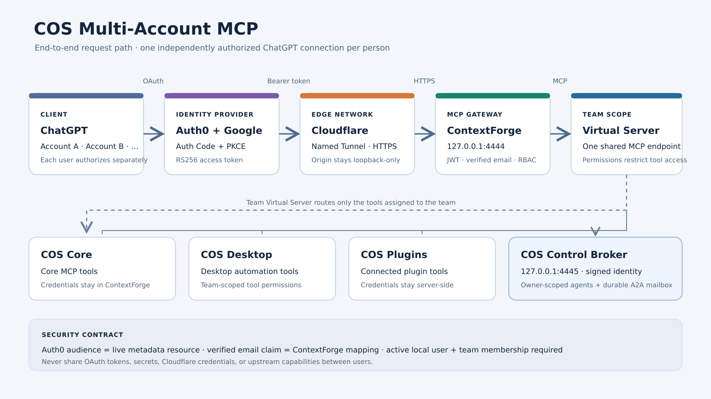
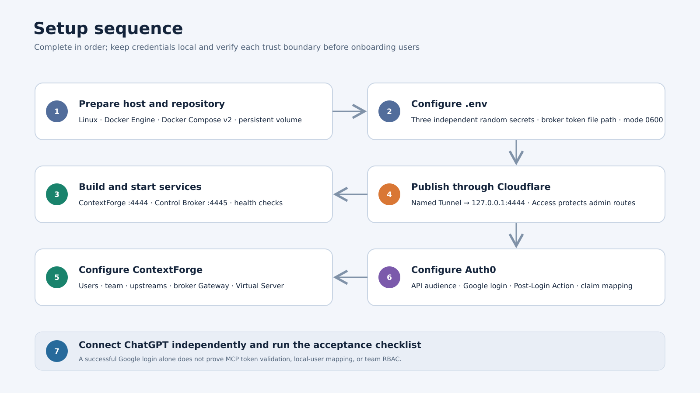
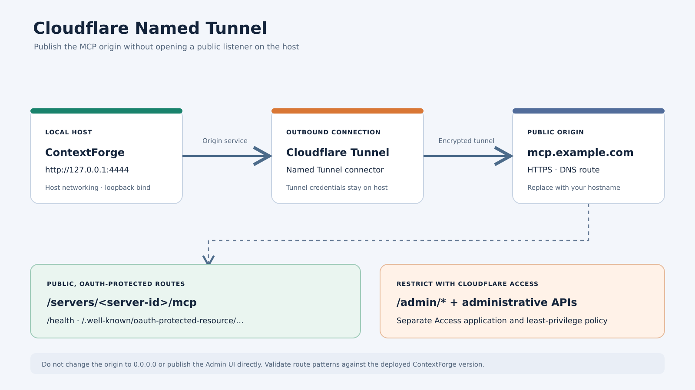
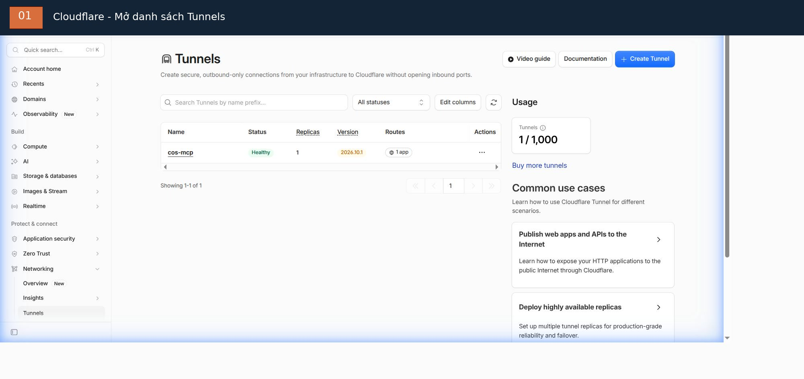
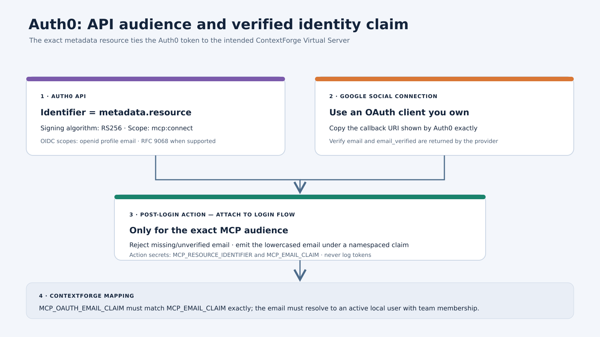
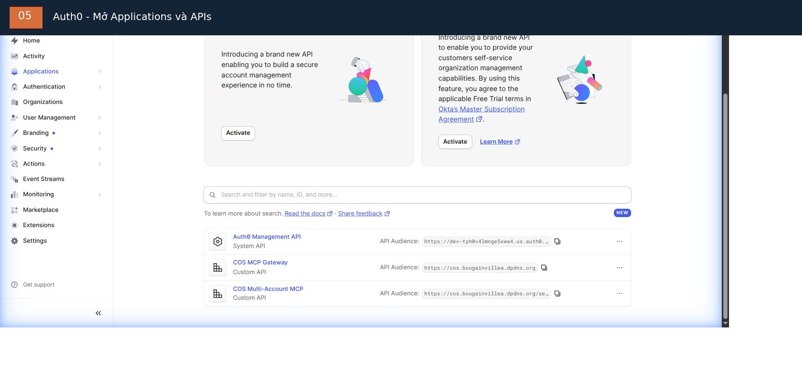

# COS Multi-Account MCP — hướng dẫn thiết lập

> Ngôn ngữ: [English](getting-started.md) | Tiếng Việt

**Repository:** https://github.com/nplongx/cos-multi-account-mcp

**Operator runbook:** [deployment-guide.vi.md](deployment-guide.vi.md)

**Bản Gist công khai cũ:** https://gist.github.com/nplongx/1f17336a782a99fb4d0d15181532a5b9

Hướng dẫn này bao gồm chuẩn bị host, deployment, OAuth setup, kết nối ChatGPT và kiểm tra bảo mật. Thư mục `docs/` trong repository là nguồn sự thật được version-control; Gist cũ chỉ là bản tiện tra cứu và có thể không cập nhật bằng tài liệu này.

> **Mới sử dụng Auth0 hoặc Cloudflare?** Làm theo [hướng dẫn dashboard từng bước bằng tiếng Việt](dashboard-walkthrough.vi.md). Hướng dẫn chỉ rõ cần bấm ở đâu, nhập gì và setting nào chỉ cần kiểm tra thay vì tạo lại.

> **Trạng thái: development / trial.** Các kiểm tra deployment ban đầu đã pass, nhưng luồng đầy đủ ChatGPT token -> verified email claim -> ContextForge team/RBAC chưa được nghiệm thu end-to-end. Không coi cấu hình này là sẵn sàng production.



*Sơ đồ kiến trúc minh họa, không phải ảnh chụp dashboard live.* Video walkthrough ngắn có dạng [MP4](assets/setup-walkthrough.mp4) hoặc [animated GIF](assets/setup-walkthrough.gif). Source diagram là SVG có thể chỉnh sửa; render lại toàn bộ media bằng `bash docs/assets/render.sh` (cần FFmpeg có `librsvg` decoder).

## 1. Kiến trúc

```text
ChatGPT client -- OAuth Authorization Code + PKCE --> Auth0 + Google
      |
      | HTTPS MCP request + per-user bearer token
      v
Cloudflare Named Tunnel --> ContextForge (127.0.0.1:4444)
                                  |
                                  | validate issuer/audience/scope/email claim
                                  v
                         active local user + team RBAC
                                  |
                                  v
                      Team Virtual Server + tool ACLs
                         |       |       |       |
                      Core   Desktop  Plugins  Broker (:4445)
                                                  |
                                          Local Control API + A2A mailbox
```

Mỗi người tự authorize ChatGPT connection của mình. Không bao giờ chia sẻ access token, refresh token, OAuth client secret, tunnel credential hoặc upstream capability credential.

## 2. Điều kiện tiên quyết



Chuẩn bị Linux host có Docker Engine và Docker Compose v2, Cloudflare account với Named Tunnel và hostname bạn kiểm soát, Auth0 tenant, Google OAuth client thuộc quyền sở hữu của bạn, cùng quyền administrator trên ContextForge và COS Control API.

Kiểm tra Docker:

```bash
docker version
docker compose version
```

Deployment dùng host networking và loopback listener tại `127.0.0.1:4444` (ContextForge) và `127.0.0.1:4445` (COS Control Broker). Không expose trực tiếp hai port này ra Internet.

## 3. Clone và cấu hình

```bash
git clone https://github.com/nplongx/cos-multi-account-mcp.git
cd cos-multi-account-mcp
cp .env.example .env
chmod 600 .env
```

Tạo ba secret độc lập. Mỗi lệnh in ra một giá trị ngẫu nhiên 32 byte khác nhau; chỉ copy từng giá trị vào đúng biến `.env` tương ứng:

```bash
for name in JWT_SECRET_KEY AUTH_ENCRYPTION_SECRET COS_IDENTITY_HMAC_SECRET; do
  printf '%s=' "$name"
  openssl rand -hex 32
done
```

Chỉnh sửa `.env`, thay mọi placeholder. Giữ `JWT_SECRET_KEY`, `AUTH_ENCRYPTION_SECRET` và `COS_IDENTITY_HMAC_SECRET` độc lập. `COS_CONTROL_API_TOKEN_HOST_PATH` phải trỏ tới bản sao token riêng mà broker có thể đọc như mô tả trong [deployment.vi.md](deployment.vi.md), không phải token được dán trực tiếp vào `.env`.

| Biến | Giá trị bắt buộc |
| --- | --- |
| **APP_DOMAIN** | Public HTTPS origin, ví dụ `https://mcp.example.com` |
| **MCP_OAUTH_EMAIL_CLAIM** | Namespaced claim URI chính xác do Auth0 phát ra |
| **JWT_SECRET_KEY** | Secret ngẫu nhiên thứ nhất |
| **AUTH_ENCRYPTION_SECRET** | Secret thứ hai, khác giá trị thứ nhất |
| **COS_IDENTITY_HMAC_SECRET** | Secret ngẫu nhiên thứ ba; ít nhất 32 byte |
| **PLATFORM_ADMIN_EMAIL** | Email bootstrap admin của operator |
| **PLATFORM_ADMIN_PASSWORD** | Mật khẩu bootstrap admin mạnh, riêng biệt |
| **PLATFORM_ADMIN_FULL_NAME** | Tên hiển thị bootstrap admin |
| **DEFAULT_USER_PASSWORD** | Mật khẩu default-user riêng biệt, mạnh |
| **BASIC_AUTH_PASSWORD** | Mật khẩu Basic Auth riêng biệt |
| **COS_CONTROL_API_URL** | COS Control API local, thường là `http://127.0.0.1:37121` |
| **COS_CONTROL_API_TOKEN_HOST_PATH** | Đường dẫn host tuyệt đối tới token file broker có thể đọc; xem [deployment.vi.md](deployment.vi.md) |

Các biến `COS_A2A_*` trong `.env.example` là mailbox limit có giá trị mặc định; chỉ thay đổi sau khi review broker quota behavior. Không tái sử dụng password hoặc secret. Giữ mode `.env` là `0600`. Không bao giờ đưa giá trị thật vào `.env.example`, source code, GitHub issue, Gist, screenshot hoặc shell history.

Broker còn yêu cầu COS Control API actions được bật (`controlApi.enabled=true` và `controlApi.allowActions=true`). Giữ token gốc ở mode `0600`. Tạo bản sao riêng cho broker tại `/home/<user>/.config/chat-on-steroids/control-api/broker-token`, owner là host operator và group `10001`, mode `0640`; đặt `COS_CONTROL_API_TOKEN_HOST_PATH` trỏ tới đường dẫn tuyệt đối này. Ví dụ:

```bash
install -o "$(id -u)" -g 10001 -m 0640 \
  "$HOME/.config/chat-on-steroids/control-api/token" \
  "$HOME/.config/chat-on-steroids/control-api/broker-token"
```

Broker mount file này read-only. Không bao giờ dán nội dung file vào `.env`. Xem hợp đồng triển khai tại [deployment.vi.md](deployment.vi.md#1-cấu-hình-secret).

## 4. Build và khởi động

Tạo persistent volume một lần:

```bash
docker volume create cos-contextforge-data
docker compose config -q
docker compose build
docker compose up -d
docker compose ps
docker compose logs --tail=100 contextforge
docker compose logs --tail=100 cos-control-broker
```

Kiểm tra cả hai local health endpoint:

```bash
curl -fsS http://127.0.0.1:4444/health
curl -fsS http://127.0.0.1:4445/healthz
```

Compose bind ContextForge vào `127.0.0.1:4444` và broker vào `127.0.0.1:4445` bằng host networking. Giữ cả hai listener chỉ trên loopback. External volume `cos-contextforge-data` lưu gateway state; broker có volume riêng `cos-agent-broker-data`. Không dùng `docker compose down -v` cho restart thông thường.

## 5. Cấu hình Cloudflare Tunnel





Ảnh là snapshot tại một thời điểm của Tunnel `cos-mcp` hiện có. Ảnh cho thấy trạng thái và route count được quan sát; không chứng minh route trỏ tới đúng origin. Mở Tunnel và xác minh hostname public cùng Service URL riêng.

Tạo hoặc dùng lại **Named Tunnel**, sau đó thêm public-hostname route:

| Setting | Giá trị |
| --- | --- |
| Hostname | MCP hostname của bạn |
| Service | HTTP |
| Origin URL | `http://127.0.0.1:4444` |

Xác nhận hostname DNS route đang active. Đặt `APP_DOMAIN` bằng HTTPS origin tương ứng rồi restart:

```bash
docker compose up -d
```

Bảo vệ ContextForge Admin UI và administrative API bằng Cloudflare Access application riêng, theo least-privilege policy. Xác minh route pattern thực tế theo ContextForge version đang deploy; không giả định MCP hostname tự bảo vệ administrative route. Chỉ giữ Tunnel credential và Access service token trên host. Public surface chỉ nên bao gồm health, protected-resource discovery và OAuth-protected MCP endpoint.

## 6. Bootstrap ContextForge

Thông qua ContextForge Admin UI đã được bảo vệ:

1. Đăng nhập bằng bootstrap administrator trong `.env`; thay bootstrap/default credential ngay.
2. Tạo team `COS Multi-Account` (hoặc xác nhận team có sẵn đúng mục đích).
3. Provision từng người đã được phê duyệt thành ContextForge local user active. Với deployment hiện tại, dùng quy trình Auth0 không password do administrator thực hiện bên dưới; Google/Auth0 signup tự nó không tạo local ContextForge user.
4. Thêm từng user đã provision vào team với membership role least-privilege (`member` cho quyền COS Multi-Account thông thường).
5. Cấu hình COS Core, COS Desktop và COS Plugins làm upstream MCP server. Chỉ lưu upstream credential trong ContextForge.
6. Tạo Gateway tên `cos-control-broker` với URL `http://127.0.0.1:4445/mcp`, mode `direct_proxy`. Compose đã bật signed identity propagation; không tắt nó cho Gateway này.
7. Tạo team-visible Virtual Server và bật OAuth.
8. Chỉ attach upstream server dự kiến và Gateway `cos-control-broker` vào Virtual Server. Cấp cho team member dự kiến quyền `tools.read` và `tools.execute`.
9. Ghi lại server ID live của Virtual Server.
10. Lấy RFC 9728 protected-resource metadata của server.

Lấy protected-resource metadata:

```bash
curl -fsS \
  "https://<hostname>/.well-known/oauth-protected-resource/servers/<server-id>/mcp"
```

Giá trị metadata `resource` là OAuth audience chuẩn. Copy chính xác, bao gồm path và quy tắc trailing slash. Không đoán server ID hoặc dùng URL resource cũ. Chỉ refresh Gateway không tự thêm tool vào Virtual Server; cần attach tool đã import vào Virtual Server riêng. Xem [deployment.vi.md](deployment.vi.md#refresh-gateway-catalog-sau-khi-thay-đổi-broker-tool) để biết trình tự refresh.

### Provision Gmail user cho COS deployment hiện tại

Giữ ba lớp identity tách biệt:

- **Auth0 + Google login** xác thực Google identity.
- **ContextForge local user** lưu account đang active và authorization state.
- **COS Multi-Account membership** cấp quyền truy cập team Virtual Server.

Với Gmail address được phê duyệt tường minh, dùng `EmailAuthService.create_sso_user(email=..., auth_provider="auth0", is_admin=False, is_active=True, granted_by=...)`, sau đó thêm vào `COS Multi-Account` bằng `TeamManagementService.add_member_to_team(..., role="member", grant_source="manual")`.

Lưu ý: cần có `auth0` provider record đang enabled. Setting `auto_create_users` hiện là `false` và global `sso_enabled` hiện là `false`. Administrator service method là path dự kiến, cố ý tách khỏi JIT và bypass JIT auto-create, trusted-domain, approval check; chỉ dùng sau khi đã phê duyệt truy cập tường minh. Account tạo ra không password, active, non-admin (`password_hash=NULL`, ban đầu `email_verified=false`); onboarding thông thường tạo personal team/default role. Không tự đánh dấu email verified, không tạo personal team thứ hai và không dùng `viewer` làm COS membership role; service chỉ chấp nhận `owner` hoặc `member`.

Không dùng `SSOService.authenticate_or_create_user()` để provision thủ công, không bật global SSO chỉ để thêm user và không tạo Auth0 application thay thế. REST endpoint `POST /v1/admin/users/sso` phụ thuộc SSO được bật và không phải path hiện tại. Làm theo [runbook provision Gmail đầy đủ](sso-user-provisioning.vi.md), gồm dry-run script và checklist xác minh.

## 7. Cấu hình Auth0 và Google



### Auth0 API



Ảnh cho thấy entry Custom API `COS Multi-Account MCP` trong development tenant. Đây là hình tham chiếu điều hướng, không phải configuration export. Mở API và so sánh Identifier với ContextForge metadata `resource` live; dùng đúng giá trị từ môi trường của bạn.

Hai ảnh dashboard live được chụp từ browser tab hiện có và xử lý bằng FFmpeg. Raw capture nằm ngoài repository. Để xử lý capture mới mà không commit bản gốc, chạy `bash docs/assets/process-dashboard-screenshots.sh /path/to/auth0-apis-raw.jpg /path/to/cloudflare-tunnels-raw.jpg docs/assets`.

Tạo Auth0 API với:

- Identifier: đúng bằng metadata resource ở bước trước;
- signing algorithm: RS256;
- scope bắt buộc: `mcp:connect`;
- identity scope: `openid profile email`;
- RFC 9068 access-token profile khi được hỗ trợ;
- bật Resource Parameter Compatibility Profile khi MCP client yêu cầu.

Không cấu hình client-credentials flow cho user connection thông thường. Không bật `offline_access` cho tới khi refresh-token storage, rotation, revocation và recovery được thiết kế và kiểm thử.

### Google login

Dùng Google OAuth client thuộc quyền operator sở hữu. Cấu hình authorized redirect URI chính xác như Auth0 hiển thị. Thay Auth0 development keys trước production. Rà soát những third-party application nào được phép dùng Google social connection.

### Post-Login Action

Auth0 tenant hiện deploy đã có `COS Email Identity` gắn vào Post Login. Code hiện tại hard-code MCP resource Identifier và email claim URI; không đọc `MCP_RESOURCE_IDENTIFIER` hoặc `MCP_EMAIL_CLAIM` từ Action secret. Không làm theo hướng dẫn tạo secret generic bên dưới nếu chưa quyết định migrate Action sang template có tham số. Xem [dashboard-walkthrough.vi.md](dashboard-walkthrough.vi.md#5-auth0-kiểm-tra-post-login-action) để biết chính xác điều hướng và hai biến thể.

Action phải chỉ chạy cho MCP API dự kiến, từ chối email thiếu hoặc chưa xác minh và phát namespaced custom claim.

Code bên dưới là **ví dụ generic có tham số cho tenant mới**, không phải bản sao Action đang deploy trong tenant minh họa. Nó đọc hai Action secret. Tenant hiện tại hard-code resource Identifier và claim URI trong `COS Email Identity`; Secrets panel đang rỗng. Xem dashboard walkthrough trước khi sửa Action hiện tại.

Logic generic minh họa:

```javascript
exports.onExecutePostLogin = async (event, api) => {
  const expectedAudience = event.secrets.MCP_RESOURCE_IDENTIFIER;
  const claimName = event.secrets.MCP_EMAIL_CLAIM;

  if (event.resource_server?.identifier !== expectedAudience) return;

  const email = event.user?.email;
  if (!email || event.user?.email_verified !== true) {
    api.access.deny("A verified email address is required.");
    return;
  }

  api.accessToken.setCustomClaim(claimName, email.toLowerCase());
};
```

Chỉ khi dùng code generic phía trên: trong Auth0 Action editor > **Secrets** > **Add Secret**, tạo `MCP_RESOURCE_IDENTIFIER` với API Identifier chính xác và `MCP_EMAIL_CLAIM` với namespaced claim URI bạn chọn. Xác nhận cả hai tên xuất hiện, điều chỉnh sample theo event schema thực tế của tenant, test trong non-production tenant, deploy Action và attach vào Login flow. Đảm bảo Action chỉ chạy cho đúng MCP audience. Không thêm hai secret này vào Action hard-code hiện tại nếu chưa migrate code.

Với deployment minh họa hiện tại, đặt ContextForge `MCP_OAUTH_EMAIL_CLAIM=https://bougainvillea.dpdns.org/email`, khớp với Action hiện có. Với deployment generic mới, đặt nó bằng đúng URI được lưu trong `MCP_EMAIL_CLAIM`. Email trong token phải resolve tới ContextForge user đã active từ trước. Không âm thầm provision account không giới hạn từ social login.

## 8. Kết nối từng ChatGPT account

Thực hiện riêng cho từng người:

1. Dùng account/workspace hỗ trợ custom MCP connection cần thiết.
2. Thêm `https://<hostname>/servers/<server-id>/mcp`.
3. Chọn OAuth authentication.
4. Hoàn tất Auth0 redirect và đăng nhập bằng Google account dự kiến.
5. Xác minh team tool dự kiến xuất hiện.
6. Lặp lại độc lập cho từng người được cấp quyền.

Dùng OAuth client metadata và redirect URI do ChatGPT tạo. Không hard-code callback URL từ setup cũ. Không bao giờ export token của user này cho user khác.

## 9. Xác minh authentication và RBAC

- ContextForge health: `curl -i http://127.0.0.1:4444/health` — kỳ vọng HTTP 200.
- Broker health: `curl -i http://127.0.0.1:4445/healthz` — kỳ vọng HTTP 200.
- Public metadata: `https://<hostname>/.well-known/oauth-protected-resource/servers/<server-id>/mcp` — kỳ vọng HTTP 200 và resource identifier chính xác như Auth0 cấu hình.
- MCP POST chưa xác thực: gửi request không có Authorization header — kỳ vọng HTTP 401 cùng `WWW-Authenticate` resource-metadata challenge.

Với test đã xác thực, xác minh phía server (không copy bearer token vào log hoặc terminal) token có issuer dự kiến, resource audience chính xác, expiry hợp lệ, scope `mcp:connect` và namespaced email claim đã xác minh. Sau đó xác minh ContextForge ánh xạ email tới đúng local user active và thực thi team RBAC.

Test một member được phép, một non-member, một user disabled và token sai issuer/audience, `exp` đã hết hạn hoặc thiếu scope `mcp:connect`. Google login hoặc authorization-code exchange thành công tự nó không chứng minh gateway authentication hoặc RBAC. Ghi kết quả vào [verification.vi.md](verification.vi.md); không đánh dấu production acceptance hoàn tất khi còn check bắt buộc chưa được chứng minh.

## 10. Vận hành và backup

```bash
docker compose ps
docker compose logs --tail=200 contextforge
```

Trước khi upgrade, dừng service và backup named volume vào encrypted storage bên ngoài repository:

```bash
docker compose stop contextforge
docker run --rm \
  -v cos-contextforge-data:/data \
  -v "$PWD":/backup \
  alpine tar -czf /backup/contextforge-data-backup.tgz -C /data .
docker compose up -d
```

Backup chứa identity và server configuration data. Mã hóa, giới hạn quyền truy cập và không bao giờ commit. Không dùng `docker compose down -v` để restart thông thường; lệnh đó có thể xóa persistent state.

## 11. Khắc phục sự cố

| Triệu chứng | Kiểm tra |
| --- | --- |
| Container không start | `docker compose logs --tail=200 contextforge`; xác minh các `.env` value bắt buộc |
| Health check thất bại | Kiểm tra container và listener tại `127.0.0.1:4444`, `127.0.0.1:4445` |
| Public hostname không truy cập được | Kiểm tra Tunnel route, DNS, origin URL và Cloudflare |
| OAuth audience mismatch | So sánh Auth0 API Identifier và metadata resource từng byte |
| Thiếu email claim | Kiểm tra Action trigger/secret, verified email và claim URI chính xác |
| User đã xác thực nhưng bị từ chối | Kiểm tra local account state, team membership, role và Virtual Server visibility |
| Thiếu tool | Kiểm tra Gateway health, refresh Gateway catalog, attach tool vào team Virtual Server và xác minh quyền `tools.read` / `tools.execute` |

Nếu credential bị lộ, thu hồi/xoay nó tại issuer, review log và authorize lại user bị ảnh hưởng. Xóa secret khỏi commit mới nhất không loại bỏ nó khỏi Git history.

## 12. Bảo mật và production gate

Trước production:

- thay OAuth credential development/trial bằng credential production thuộc quyền sở hữu của bạn;
- rà soát Cloudflare Access coverage cho Admin UI và administrative API;
- xác minh issuer, audience, scope, email claim và expiry ở server-side;
- xác minh hành vi với active member, non-member, disabled user và invalid token;
- test backup restoration và credential rotation;
- review ContextForge update và chủ động rebuild pinned image;
- giữ secret, database file, backup và tunnel credential ngoài Git.

Bằng chứng setup ban đầu gồm health HTTP 200, protected-resource metadata HTTP 200, unauthenticated MCP HTTP 401 và một Google/Auth0 authorization-code exchange được quan sát. Nghiệm thu đầy đủ ChatGPT-issued token -> custom email claim -> ContextForge RBAC vẫn **chưa được chứng minh**. Dự án chưa sẵn sàng production.

## Tài liệu liên quan

- [Repository và source file](https://github.com/nplongx/cos-multi-account-mcp)
- [Tài liệu deployment](https://github.com/nplongx/cos-multi-account-mcp/blob/main/docs/deployment.vi.md)
- [Tham chiếu OAuth setup](https://github.com/nplongx/cos-multi-account-mcp/blob/main/docs/oauth-setup.vi.md)
- [Checklist acceptance và verification](https://github.com/nplongx/cos-multi-account-mcp/blob/main/docs/verification.vi.md)
- [Gist operator runbook chi tiết cũ](https://gist.github.com/nplongx/1f17336a782a99fb4d0d15181532a5b9)
