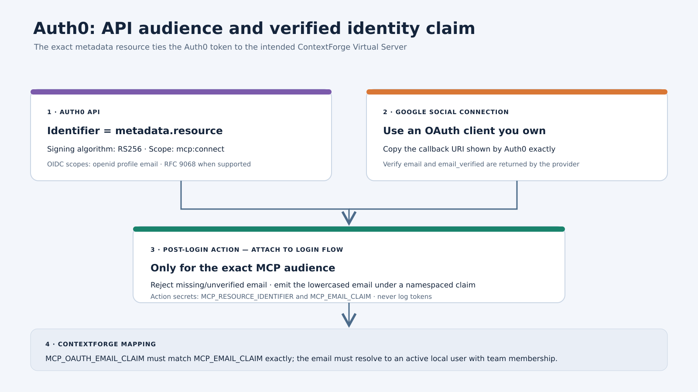
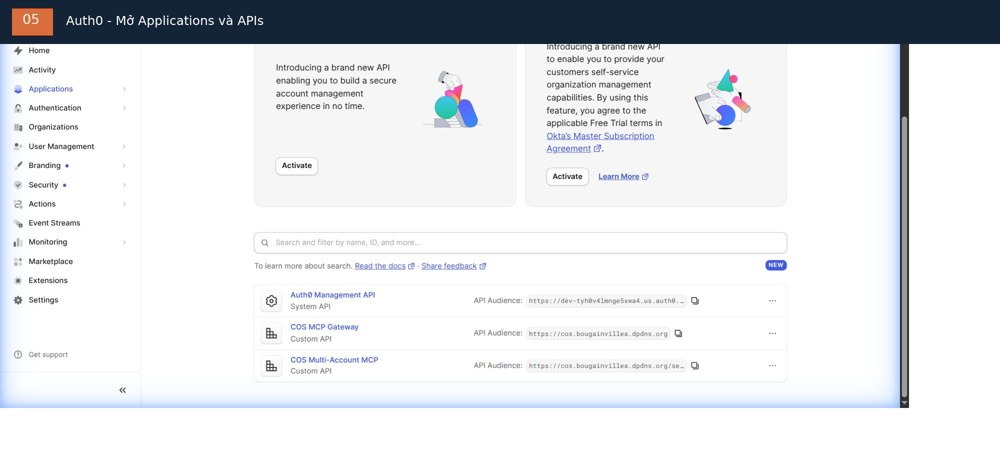

# Thiết lập OAuth: Auth0, Google và ChatGPT

> Ngôn ngữ: [English](oauth-setup.md) | Tiếng Việt

Hướng dẫn này mô tả hợp đồng cấu hình. Tên mục trong Auth0 dashboard và khả năng của ChatGPT connector có thể thay đổi; hãy xác minh hành vi provider hiện tại trước khi triển khai production.

Để xem hướng dẫn bấm từng bước với ảnh Auth0 và Cloudflare thực tế, xem [hướng dẫn dashboard bằng tiếng Việt](dashboard-walkthrough.vi.md).



Toàn bộ trình tự host, Cloudflare, ContextForge và ChatGPT nằm trong [getting-started.vi.md](getting-started.vi.md). Sơ đồ chỉ mang tính minh họa; dùng metadata và giá trị live của deployment của bạn.

## 1. Tạo Auth0 API



Dashboard hiện tại liệt kê `COS Multi-Account MCP` là Custom API. Mở API này để kiểm tra Identifier và signing configuration; Identifier phải khớp chính xác với metadata `resource` live của ContextForge. Không lấy audience từ API khác trong cùng tenant.

Tạo API có Identifier bằng đúng `resource` trả về từ live ContextForge protected-resource metadata endpoint:

```text
https://<your-hostname>/servers/<server-id>/mcp
```

Dùng giá trị chính xác từng byte. Không tự thêm hoặc bỏ trailing slash.

Cấu hình:

- token signing algorithm: RS256;
- access-token profile: RFC 9068, khi tenant/client combination hỗ trợ;
- scope bắt buộc: `mcp:connect`;
- OIDC scope cho identity: `openid profile email`;
- Resource Parameter Compatibility Profile: bật khi ChatGPT client yêu cầu;
- không dùng client-credentials grant cho user connection thông thường.

Không yêu cầu `offline_access` trừ khi refresh-token policy đã được thiết kế, review và kiểm thử tường minh.

## 2. Cấu hình Google login

Cấu hình Google social connection trong Auth0 bằng OAuth client thuộc quyền sở hữu của deployment operator.

Môi trường ban đầu dùng Auth0 development keys. Các key này chỉ dành cho testing. Trước production:

1. Tạo Google OAuth client do bạn sở hữu.
2. Cấu hình authorized redirect URI chính xác lấy từ Auth0.
3. Thay development key trong Auth0.
4. Rà soát social connection được bật cho mọi third-party application hay chỉ client dự kiến.
5. Xác nhận provider trả `email` và `email_verified`.

Tránh yêu cầu thêm Google scope rộng nếu không cần thiết.

## 3. Thêm Post-Login Action

> **Quan trọng — generic template và tenant hiện tại:** mẫu bên dưới là template có tham số, đọc `MCP_RESOURCE_IDENTIFIER` và `MCP_EMAIL_CLAIM` từ Action secret. Auth0 tenant trong ảnh hiện dùng một Action `COS Email Identity` khác và đã deploy: resource Identifier và claim URI được hard-code trong code Action, Secrets panel rỗng, Action đã gắn vào Post Login. Không thêm hai generic secret vào Action hiện có trừ khi trước tiên thay code bằng template có tham số và review/test thay đổi. Xem [hướng dẫn dashboard tiếng Việt](dashboard-walkthrough.vi.md#5-auth0-kiểm-tra-post-login-action) để biết trạng thái và ảnh thực tế.

Action phải:

- chỉ áp dụng cho đúng MCP API audience;
- từ chối login nếu thiếu email hoặc `email_verified` không phải true;
- phát email đã xác minh dưới đúng custom claim URI cấu hình trong ContextForge;
- không đưa token hoặc secret vào log.

Logic Action minh họa (điều chỉnh event/secret name theo Auth0 tenant):

```javascript
exports.onExecutePostLogin = async (event, api) => {
  const expectedAudience = event.secrets.MCP_RESOURCE_IDENTIFIER;
  const claimName = event.secrets.MCP_EMAIL_CLAIM;

  if (event.resource_server?.identifier !== expectedAudience) {
    return;
  }

  const email = event.user?.email;
  if (!email || event.user?.email_verified !== true) {
    api.access.deny("A verified email address is required.");
    return;
  }

  api.accessToken.setCustomClaim(claimName, email.toLowerCase());
};
```

Chỉ với **generic template này**, lưu `MCP_RESOURCE_IDENTIFIER` và `MCP_EMAIL_CLAIM` thành Action secret. Đặt `MCP_OAUTH_EMAIL_CLAIM` trong ContextForge bằng cùng claim URI. Save và deploy Action, sau đó gắn rõ ràng vào Login flow; Action chưa deploy hoặc chưa gắn sẽ không chạy khi login.

## 4. Provision ContextForge user

Tạo ContextForge local account và cấp team membership trước khi kỳ vọng email claim đã xác minh được ánh xạ sang quyền ContextForge. Với deployment hiện tại, làm theo [runbook provision Gmail bằng Auth0](sso-user-provisioning.vi.md). Quy trình dùng đường `EmailAuthService.create_sso_user()` chỉ dành cho administrator và thêm account vào `COS Multi-Account` với membership role `member`.

Không nhầm thao tác này với `SSOService.authenticate_or_create_user()`, vốn xử lý inbound SSO callback và JIT creation. Provider hiện tại có `auto_create_users=false`. Google signup/login trong ChatGPT Auth0 application không phải ContextForge local provisioning và không tạo team membership.

Gateway phải resolve token identity đã xác minh thành local user được cấp quyền từ trước. Không bật JIT creation không giới hạn như lối tắt để thêm người đã được duyệt.

## 5. Cấu hình ChatGPT

1. Dùng ChatGPT workspace/account hỗ trợ custom MCP connector cần thiết.
2. Thêm HTTPS MCP endpoint của team Virtual Server.
3. Chọn OAuth authentication.
4. Hoàn tất Auth0 authorization flow và đăng nhập bằng Google account dự kiến.
5. Lặp lại độc lập cho từng account. Không bao giờ chia sẻ token giữa các account.
6. Xác nhận connection liệt kê đúng tool mong đợi.

Dùng OAuth client metadata và redirect URI do ChatGPT tạo. Không hard-code callback URL từ lần setup trước.

## 6. Token claim bắt buộc

Xác thực access token ở phía server mà không copy token vào ticket, Gist, source file hoặc shell history. Claim mong đợi gồm:

- `iss`: Auth0 issuer đã cấu hình;
- `aud`: ContextForge resource identifier chính xác;
- `exp`: thời điểm hết hạn hợp lệ;
- `scope`: có `mcp:connect`;
- custom email claim: email đã xác minh, khớp ContextForge local user đang active.

Google login hoặc Auth0 code exchange thành công tự nó không chứng minh ContextForge đã chấp nhận token hoặc thực thi RBAC.
